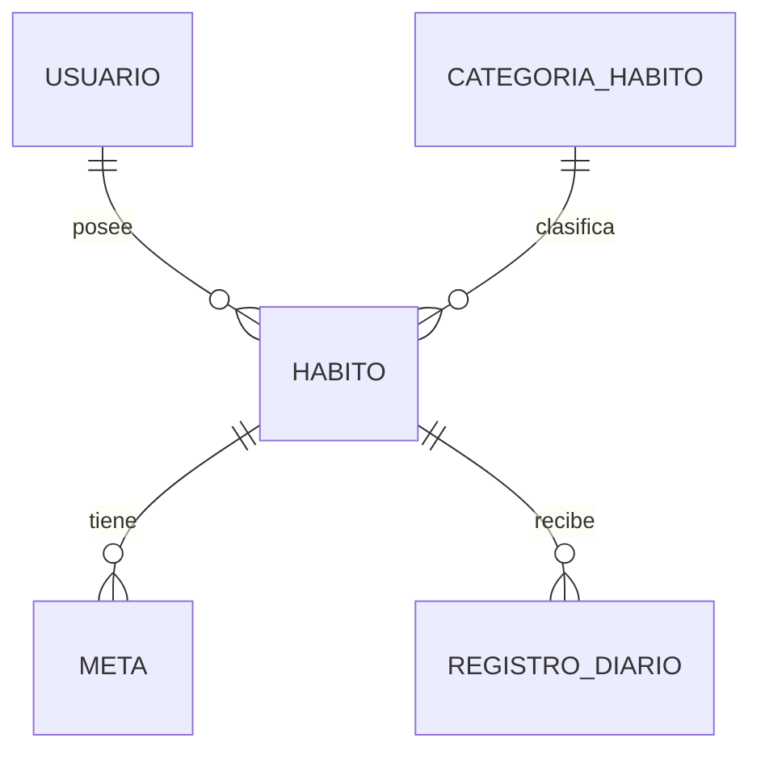

# Guía completa del proyecto — Healthy Habits Tracker

> **Para qué sirve esta guía:** estudiar el proyecto desde cero, entender cómo funciona cada
> parte del código, ejecutarlo en Windows y prepararse para la sustentación.
>
> **Estado que describe:** el código de la copia de trabajo `healthy-habits-tracker-claude-trabajo`
> al **2026-10-25**, después de la auditoría final. Todo lo que aquí se afirma como "funciona" fue
> comprobado con pruebas automáticas o ejecutándolo; lo que no se pudo comprobar está marcado.
>
> **⚠️ Actualización del corte 3 (2026-10-28).** Esta guía describe el estado del **2026-10-25**, cuando
> la app y el backend vivían juntos (`backend/`). Desde entonces el proyecto se separó en cuatro
> repositorios (ADR-010) y se añadieron roles, panel del profesional, edición completa y registro sin
> conexión (ADR-011). Donde esta guía diga `backend/…`, léase el repositorio `habits-tracker-api`.
> Para lo nuevo, la fuente vigente es: [ADR-011](./01-architecture/decisions/records/ADR-011-roles-y-alcance-completo.md),
> [api-contract.md](./03-api-and-data/api-contract.md), [offline-sync.md](./03-api-and-data/offline-sync.md),
> [feature-panel-profesional.md](./01-architecture/features/feature-panel-profesional.md) y los manuales de implementación y de uso.
>
> **Equipo:** Juan José Horta Vanegas · Daniel Felipe Fernandez Rojas.
> CORHUILA · Ingeniería de Sistemas · Programación Móvil 2026-B.

---

## Índice

1. [Qué es la aplicación](#1-qué-es-la-aplicación)
2. [Tecnologías y para qué se usa cada una](#2-tecnologías-y-para-qué-se-usa-cada-una)
3. [Arquitectura general](#3-arquitectura-general)
4. [Estructura de archivos](#4-estructura-de-archivos)
5. [La app móvil, módulo por módulo](#5-la-app-móvil-módulo-por-módulo)
6. [El backend, módulo por módulo](#6-el-backend-módulo-por-módulo)
7. [La base de datos](#7-la-base-de-datos)
8. [La API REST](#8-la-api-rest)
9. [Recorridos completos de las funcionalidades](#9-recorridos-completos-de-las-funcionalidades)
10. [Pruebas automatizadas](#10-pruebas-automatizadas)
11. [Conceptos de programación y Clean Code en este código](#11-conceptos-de-programación-y-clean-code-en-este-código)
12. [Cómo instalar y ejecutar el proyecto en Windows](#12-cómo-instalar-y-ejecutar-el-proyecto-en-windows)
13. [Problemas frecuentes y cómo diagnosticarlos](#13-problemas-frecuentes-y-cómo-diagnosticarlos)
14. [Preparación para la sustentación](#14-preparación-para-la-sustentación)
15. [Tabla de cobertura de esta guía](#15-tabla-de-cobertura-de-esta-guía)

---

## 1. Qué es la aplicación

### 1.1 El problema

Los pacientes de un centro de bienestar reciben recomendaciones (tomar agua, caminar, dormir
bien, meditar), pero al volver a su rutina pierden la constancia: no tienen una forma rápida de
anotar lo que hacen ni de ver su progreso (HU-02 §1). La app permite **registrar cada día cuánto
se cumplió de un hábito, saber si se alcanzó la meta y ver crecer la racha** de días consecutivos.

### 1.2 Usuarios

| Usuario (HU-02 §2) | Qué hace en la app hoy |
|---|---|
| **Paciente** ("Carlos") | Todo lo que existe: cuenta, hábitos, metas, registros, rachas, historial |
| **Profesional de bienestar** ("Dra. Laura") | **Nada todavía.** El panel de reportes (M-09) no está implementado y el modelo no tiene roles (ADR-008, D-24) |
| **Administrador del centro** ("Roberto") | Indirectamente: el catálogo de 5 categorías lo define el sistema y el paciente no puede modificarlo |

### 1.3 Funcionalidades implementadas

| Funcionalidad | Requisito (HU-02) |
|---|---|
| Crear cuenta e iniciar sesión con contraseña cifrada (bcrypt) y token JWT | M-01, M-02 |
| Catálogo de 5 categorías (Hidratación, Ejercicio, Alimentación, Sueño, Meditación) | M-03 |
| Crear, listar y eliminar hábitos; si tienen historial se **archivan** en lugar de borrarse | M-04 |
| Metas cuantitativas con **una sola meta activa** por hábito | M-05 |
| Registro diario con **un único registro por hábito y fecha** | M-06 |
| Racha actual y racha máxima | M-07 |
| Dashboard con métricas del día, gráfica semanal y rachas | M-08, S-01 |
| Backend en Docker Compose | M-10 |
| App móvil Android/iOS/web desde una sola base de código | M-11 (iOS sin verificar) |
| Lista de registros con filtro por hábito y eliminación | M-12 |
| Historial por mes y por semana | S-02 |
| Errores del API con forma única (RFC 7807) | S-03 |
| Validación de datos que rechaza campos no permitidos | S-04 |
| Caché local: la app abre con datos aunque no haya red | S-05 |

### 1.4 Lo que **no** hace (y conviene decirlo con honestidad)

- **Registrar sin conexión** (cola de pendientes, S-06): sin red, guardar un registro falla con un mensaje claro.
- **Panel del profesional** (M-09) y roles de usuario.
- **Editar** hábitos, metas o registros desde la app (C-04). El API sí permite modificar hábitos (`PUT /habitos/:id`), pero ninguna pantalla lo usa todavía, salvo para reactivar un hábito archivado (tampoco hay botón para eso aún).
- Pantalla de perfil, recordatorios, exportar a PDF.

---

## 2. Tecnologías y para qué se usa cada una

Versiones tomadas de los `package.json` y `node_modules` del proyecto.

### 2.1 App móvil (raíz del repositorio de código)

| Tecnología | Versión | Para qué se usa aquí |
|---|---|---|
| **React Native** | 0.86.3 | Dibujar interfaces nativas (Android/iOS) con componentes como `View`, `Text`, `FlatList` |
| **Expo** (SDK) | 57 (`expo` 57.0.20) | Herramientas de desarrollo: Expo Go, empaquetado (`expo export`), módulos como `expo-secure-store` |
| **React** | 19.2.3 | Componentes, estado (`useState`), efectos (`useEffect`), contexto (`createContext`) |
| **TypeScript** | 6.0 (modo `strict`) | Tipos: el compilador detecta errores antes de ejecutar |
| **React Navigation** | 7 (`native-stack`, `bottom-tabs`) | Navegación: stack raíz, pestañas inferiores y modal |
| **expo-secure-store** | 57.0.x | Guardar el token en Keychain (iOS) / Keystore (Android) |
| **@react-native-async-storage/async-storage** | 2.2.0 | Caché del dominio (hábitos, metas, registros) en el teléfono |
| **expo-crypto** | 57.0.x | Generar el `clienteId` (UUID v4) de cada registro |
| **react-native-web** + **react-dom** | 0.21 / 19.2.3 | Ejecutar la misma app en el navegador |
| **Jest** + **jest-expo** | 29.7 / 57.0.x | Ejecutar las pruebas |
| **React Native Testing Library** | 13.3.3 | Probar el contexto (`renderHook`) como lo usaría un componente |

### 2.2 Backend (`backend/`)

| Tecnología | Versión | Para qué se usa aquí |
|---|---|---|
| **Node.js** | 20 en Docker (`node:20-alpine`) | Ejecutar el servidor |
| **NestJS** | 10.4.22 | Organizar el servidor en módulos, controladores y servicios con inyección de dependencias |
| **Prisma** | 5.22.0 | Definir el esquema, generar migraciones SQL y consultar la base con tipos |
| **PostgreSQL** | 16 (`postgres:16-alpine`) | Base de datos relacional |
| **class-validator / class-transformer** | 0.14.1 / 0.5.1 | Validar y normalizar los datos que llegan (DTO) |
| **@nestjs/jwt**, **Passport** (`passport-jwt`) | 10.2.0 / 0.7 / 4.0.1 | Emitir y verificar tokens JWT |
| **bcryptjs** | 2.4.3 | Hash de contraseñas (mismo algoritmo que `bcrypt`, en JavaScript puro: no hay que compilar nada en Docker) |
| **Docker / Docker Compose** | — | Levantar PostgreSQL y el API con un comando |
| **Jest** + **Supertest** | 29 / 7 | Pruebas unitarias y de extremo a extremo (peticiones HTTP reales) |
| **ESLint** + **Prettier** | 8 / 3 | Calidad y formato del código del backend |

> Las versiones de NestJS (10) y Prisma (5) son las que fijó HU-01. Hoy existen versiones más
> nuevas y `npm audit` reporta vulnerabilidades en la línea NestJS 10 (ver §14.7).

---

## 3. Arquitectura general

### 3.1 Mapa

```mermaid
flowchart LR
    subgraph TEL["Teléfono / navegador"]
        UI["Pantallas (screens/)\ny componentes (components/)"]
        CTX["AppContext\nestado global + acciones"]
        SRV["services/\napiFetch + módulos por recurso"]
        STO["storage/\nseguro.ts (token)\ncache.ts (caché)"]
        UI -->|useApp()| CTX
        CTX --> SRV
        CTX --> STO
    end

    subgraph DOCKER["Docker Compose (PC)"]
        API["API NestJS :3000/api/v1\ncontroladores → servicios"]
        DB[("PostgreSQL 16\nhabitos_saludables_db")]
        API -->|Prisma| DB
    end

    SRV -->|"HTTP + JSON\nAuthorization: Bearer JWT"| API
```

### 3.2 Responsabilidades

| Parte | Responsabilidad | No hace |
|---|---|---|
| **Pantallas** (`src/screens/`) | Mostrar datos, mantener el estado del formulario, llamar acciones del contexto y mostrar su resultado | No llaman al API ni guardan nada directamente |
| **Componentes** (`src/components/`) | Piezas visuales reutilizables que reciben todo por props | No usan el contexto |
| **Contexto** (`src/context/AppContext.tsx`) | Guardar el estado global, exponer acciones (`crearRegistro`, …), coordinar sesión, red y caché | No dibuja nada |
| **Servicios** (`src/services/`) | Hablar con el API: URL, token, timeout, reintentos, errores | No conocen React |
| **Almacenamiento** (`src/storage/`) | Token en almacenamiento seguro; caché en AsyncStorage | — |
| **Utilidades** (`src/utils/`) | Funciones puras: fechas, racha, números | No importan React |
| **API** (`backend/`) | Autenticar, **imponer las reglas de negocio**, guardar en PostgreSQL | No sabe de pantallas |
| **PostgreSQL** | Guardar los datos y garantizar restricciones (`UNIQUE`, `CHECK`, claves foráneas) | — |

**Idea central:** el servidor es la autoridad. La app ya no repite las reglas de negocio (antes,
en la v1.0.0, vivían en el `AppContext`); ahora las impone el API y la app muestra su respuesta.

### 3.3 Qué pasa desde que se abre la app

```
index.ts → App.tsx → AppProvider (AppContext) → AppNavigator
   │
   ├─ AppContext al montarse:
   │    1. borra claves de caché de versiones viejas
   │    2. lee el token guardado (expo-secure-store)
   │       ├─ no hay token → estadoSesion = 'sin-sesion' → se ve Login
   │       └─ hay token    → estadoSesion = 'con-sesion'
   │            a. lee la caché → si existe, muestra esos datos al instante
   │            b. GET /usuarios/me → perfil
   │            c. GET /categorias, /habitos, /metas, /registros (en paralelo)
   │            d. reemplaza los datos y vuelve a guardar la caché
   │
   └─ AppNavigator decide qué mostrar:
        'iniciando'            → PantallaEstado "Abriendo tu sesión…"
        con sesión + cargando  → PantallaEstado "Cargando tus hábitos…"
        con sesión + error     → PantallaEstado con "Reintentar" / "Cerrar sesión"
        con sesión             → Tabs (Inicio, Hábitos, Metas, Registros, Historial)
        sin sesión             → Login / Registro
```

---

## 4. Estructura de archivos

### 4.1 Repositorio de código (`healthy-habits-tracker`)

```
healthy-habits-tracker/
├── App.tsx                     Monta SafeAreaProvider, AppProvider y AppNavigator
├── index.ts                    Punto de entrada de Expo (registerRootComponent)
├── app.json                    Nombre, tema oscuro, esquema habitos://, plugin expo-secure-store
├── package.json                Dependencias y scripts (start, web, test…)
├── tsconfig.json               TypeScript strict; excluye backend/; tipos de Jest
├── jest.config.js              Preset jest-expo; ignora backend/
├── .env.example                Plantilla de EXPO_PUBLIC_API_URL
├── src/
│   ├── components/             AppButton, AvisoSinConexion, Badge, Card, ChipSelector,
│   │                           EmptyState, Input, PantallaEstado, ScreenHeader,
│   │                           SegmentedTabs, StatCard, WeekChart, dialogos.ts
│   ├── constants/theme.ts      Colores, espaciados, radios, tamaños de letra
│   ├── context/AppContext.tsx  Estado global (+ AppContext.test.tsx)
│   ├── navigation/             AppNavigator.tsx (stack + guardia), TabNavigator.tsx
│   ├── screens/                Login, Register, Dashboard, Habitos, Metas, Registros,
│   │                           NuevoRegistro, Historial
│   ├── services/               api.ts (+ test), auth.ts, habitos.ts, metas.ts, registros.ts
│   ├── storage/                seguro.ts, cache.ts (+ test)
│   ├── types/index.ts          Tipos del dominio y de las rutas
│   └── utils/                  date.ts, racha.ts, numeros.ts (+ sus pruebas)
└── backend/
    ├── Dockerfile, docker-compose.yml, .env.example, .dockerignore
    ├── package.json, tsconfig*.json, nest-cli.json, .eslintrc.js, .prettierrc
    ├── prisma/
    │   ├── schema.prisma
    │   └── migrations/         20261026015453_inicial, 20261026015649_catalogo_categorias
    ├── src/
    │   ├── main.ts, configurar-app.ts, app.module.ts
    │   ├── config/validar-entorno.ts (+ spec)
    │   ├── prisma/             PrismaService, PrismaModule
    │   ├── common/             errores/, validacion/, fechas.ts (+ spec)
    │   ├── auth/               controlador, servicio, DTO, JWT (estrategia, guardia, decoradores)
    │   ├── usuarios/           GET /usuarios/me
    │   ├── categorias/         GET /categorias
    │   ├── habitos/            CRUD + archivado + rachas
    │   ├── metas/              metas con una sola activa por hábito
    │   └── registros/          registros diarios, idempotencia, racha.ts (+ spec)
    └── test/                   pruebas e2e (auth, seguridad, habitos, metas, registros) y ayudantes
```

**Qué no se explica archivo por archivo, y por qué:**
- `node_modules/`, `dist/`, `package-lock.json`: generados por herramientas; no se editan a mano.
- `nest-cli.json`, `tsconfig.build.json`, `.eslintrc.js`, `.prettierrc`, `babel.config.js`: configuración estándar generada por NestJS y Expo, sin lógica propia.
- `backend/prisma/migrations/migration_lock.toml`: archivo de control de Prisma (indica el motor `postgresql`).

### 4.2 Repositorio de documentación (`habits-tracker-docs`)

| Carpeta | Contenido |
|---|---|
| `Project/` | HU-01 (stack), HU-02 (discovery, MoSCoW, wireframes, modelo, flujos) |
| `00-governance/` | Ágil, Git, DoR/DoD, reglas de seguridad, retrospectivas, integrantes del equipo |
| `01-architecture/` | Estructura, capas, navegación, ADR-001 a ADR-009, features y pantallas |
| `02-code-and-ui/` | Estándares de código, sistema de diseño, accesibilidad, i18n, componentes |
| `03-api-and-data/` | **Contrato de API** (`api-contract.md`), **modelo de datos** (`data-model.md`), red, autenticación, persistencia, offline |
| `04-quality/` | Estrategia de pruebas, presupuestos de rendimiento, seguridad móvil, casos TC-001 a TC-004 |
| `05-release/` | CI/CD, firma, observabilidad, release v1.0.0; `healthy-habits-tracker/` es la copia **obsoleta** de la v1.0.0 |

---

## 5. La app móvil, módulo por módulo

### 5.1 Punto de entrada: `index.ts` y `App.tsx`

- **`index.ts`** llama a `registerRootComponent(App)`, que registra el componente raíz para que funcione igual en Expo Go y en una build nativa.
- **`App.tsx`** envuelve todo en tres capas:

```tsx
<SafeAreaProvider>      {/* márgenes seguros (notch, barra de estado) */}
  <AppProvider>         {/* estado global: sesión y datos */}
    <StatusBar style="light" />
    <AppNavigator />    {/* decide qué pantalla se ve */}
  </AppProvider>
</SafeAreaProvider>
```

El orden importa: `AppNavigator` usa `useApp()`, así que tiene que estar **dentro** de `AppProvider`.

### 5.2 Tipos del dominio: `src/types/index.ts`

Define la forma de los datos. Son los mismos campos que devuelve el API (ADR-008, D-28):

| Tipo | Campos | Nota |
|---|---|---|
| `Usuario` | `id, nombres, apellidos, correo, edad, peso, estatura` | Los opcionales son `null`. **Nunca** tiene `contrasena` |
| `DatosNuevaCuenta` | lo anterior + `contrasena` | Solo viaja al registrarse |
| `CategoriaHabito` | `id, nombre, icono` | `icono` es un emoji |
| `Habito` | `id, categoriaHabitoId, nombre, descripcion, unidadMedida, frecuencia, activo` | `activo: false` = archivado |
| `Meta` | `id, habitoId, valorObjetivo, descripcion, activa` | |
| `RegistroDiario` | `id, habitoId, fecha, valorRegistrado, metaCumplida, notas` | `fecha` es texto `'YYYY-MM-DD'` (ADR-003) |
| `Racha` | `habitoId, rachaActual, rachaMaxima` | Valor calculado, no guardado |
| `RootStackParamList`, `TabParamList` | nombres de rutas y sus parámetros | TypeScript impide navegar a una ruta que no existe |

### 5.3 Utilidades puras: `src/utils/`

Son funciones que reciben datos y devuelven datos: no usan React, ni red, ni almacenamiento. Por
eso se prueban fácilmente.

#### `date.ts` — fechas como texto (ADR-003)

**Por qué existe:** un registro es un *día*, no un instante. Si se usara `new Date().toISOString()`,
un registro hecho a las 8 p. m. en Colombia (UTC-5) quedaría con la fecha del día siguiente en UTC.
Por eso todas las fechas de registro son texto `'YYYY-MM-DD'` construido con la hora **local**.

| Función | Qué hace | Cómo |
|---|---|---|
| `aISO(fecha)` | `Date` → `'YYYY-MM-DD'` | Usa `getFullYear/getMonth/getDate` (local), **nunca** `toISOString()` |
| `aDate(iso)` | `'YYYY-MM-DD'` → `Date` a medianoche local | `new Date(anio, mes - 1, dia)` (no `new Date('2026-09-17')`, que interpreta UTC) |
| `hoyISO()` | Fecha de hoy | `aISO(new Date())` |
| `sumarDias(iso, n)` | Suma o resta días | Pasa a `Date`, usa `setDate`, vuelve a texto (maneja fin de mes y años bisiestos) |
| `diferenciaDias(a, b)` | Días entre dos fechas | Diferencia en milisegundos ÷ ms por día, redondeada |
| `inicioDeSemana(iso)` | Lunes de esa semana | `getDay()` da 0 = domingo; `(dia + 6) % 7` convierte a "días desde el lunes" |
| `semanaDe(iso)` | Las 7 fechas lunes→domingo | Para la gráfica semanal |
| `diaCorto`, `fechaLarga`, `fechaCorta`, `nombreMes`, `horaDe` | Textos para mostrar | `horaDe` da `'HH:mm'` de la última sincronización |

#### `racha.ts` — el algoritmo más importante

`calcularRacha(habitoId, registros)` devuelve `{ habitoId, rachaActual, rachaMaxima }`.

Paso a paso:

1. Se quedan solo los registros de ese hábito **con la meta cumplida**, se toman sus fechas, se
   ordenan y se invierten (de la más reciente a la más antigua).
2. Si no hay ninguna → racha 0 y 0.
3. Se recorren las fechas:
   - **Primera fecha:** la racha está "vigente" solo si es **hoy o ayer** (`diferenciaDias(hoy, fecha)`
     es 0 o 1). La tolerancia de un día es deliberada: no se castiga a quien todavía no registra hoy.
   - **Si la fecha siguiente es exactamente el día anterior** (diferencia 1) → el tramo crece.
   - **Si hay un hueco** → el tramo termina: se compara con la máxima, y si el tramo era el vigente
     se guarda como `rachaActual`. Desde ahí, `vigente = false`: los tramos más antiguos solo
     pueden mejorar la máxima, nunca la actual.
4. Al terminar, se procesa el último tramo de la misma manera.

Ejemplo (hoy = 17): cumplidos los días 17, 16, 15, hueco en 14 y 13, cumplidos del 6 al 12 →
`rachaActual = 3`, `rachaMaxima = 7`. Ese es exactamente uno de los casos probados.

> El backend tiene una copia del mismo algoritmo (`backend/src/registros/racha.ts`) para que app y
> servidor den siempre el mismo número (ADR-008, D-19). Ambas versiones pasan los mismos casos.

#### `numeros.ts` — `aNumero(texto)`

El teclado numérico en español escribe la coma decimal (`8,5`), que `Number()` no entiende. La
función recorta espacios, cambia la coma por punto y devuelve el número, o `null` si el texto no es
un número. La usan Registro, Metas y Nuevo registro.

### 5.4 Almacenamiento: `src/storage/`

#### `seguro.ts` — el token

```ts
export async function guardarToken(token: string): Promise<void> {
  if (ES_WEB) { tokenEnMemoria = token; return; }
  await SecureStore.setItemAsync(CLAVE_TOKEN, token);   // CLAVE_TOKEN = 'hst.token'
}
```

- En el teléfono usa `expo-secure-store` (Keychain/Keystore, cifrado por el sistema operativo).
- En la web no existe almacenamiento seguro: el token vive en una variable y **se pierde al recargar**.
  Es una decisión de seguridad: preferible a dejarlo legible en `localStorage`.
- Expone `guardarToken`, `leerToken`, `borrarToken`.

#### `cache.ts` — la caché del dominio (S-05, ADR-004)

Guarda en AsyncStorage una clave por colección, con versión del esquema:

| Clave | Contenido |
|---|---|
| `hst:v1:usuario` | Perfil **sin** edad, peso ni estatura |
| `hst:v1:categorias`, `hst:v1:habitos`, `hst:v1:metas`, `hst:v1:registros` | Arreglos JSON |
| `hst:v1:sincronizado` | Hora de la última carga completa desde el API |

| Función | Qué hace |
|---|---|
| `guardarColeccion(nombre, valor)` | Escribe **solo** esa clave. Si es el usuario, aplica `aPerfilBasico` (borra datos de salud). Si falla, avisa con un mensaje genérico (sin datos personales) |
| `leerDominio()` | Lee todas las claves. Si falta alguna o una no es JSON válido → `null` y borra la caché (siempre se puede reconstruir desde el API) |
| `limpiarCache()` | Borra todas las claves que empiezan por `hst:` (al cerrar sesión) |
| `descartarVersionesAnteriores()` | Borra claves `hst:` de otra versión (migración simple) |

En la web la caché está **desactivada** (`CACHE_ACTIVA = Platform.OS !== 'web'`): como el token no
sobrevive a una recarga, la caché nunca se usaría y solo dejaría datos de salud en el navegador.

### 5.5 Comunicación con el API: `src/services/`

#### `api.ts` — `apiFetch`, el único punto de salida a la red (ADR-005)

Recibe una ruta y opciones (`metodo`, `cuerpo`, `publico`) y devuelve un `Resultado<T>`:

```ts
type Resultado<T> =
  | { ok: true; datos: T }
  | { ok: false; mensaje: string; code?: string; status?: number };
```

Cómo funciona:

1. **URL base:** `process.env.EXPO_PUBLIC_API_URL`, o `http://localhost:3000/api/v1` si no está definida.
2. **Reintentos solo para lecturas:** si el método es `GET`, hasta 3 intentos (inmediato, a 1 s y a 2 s);
   cualquier otro método, un solo intento. Reintentar una escritura a ciegas podría duplicarla (D-16).
3. **Cada intento** (`intentar`):
   - crea un `AbortController` y un temporizador de **10 s** que aborta la petición si no responde;
   - arma las cabeceras; si la ruta **no** es pública, lee el token y añade `Authorization: Bearer …`;
   - hace `fetch`;
   - **5xx** o error de red/timeout → "reintentable";
   - **2xx** → `{ ok: true, datos }` (un 204 no trae cuerpo);
   - **4xx** → lee el cuerpo RFC 7807 y devuelve `{ ok: false, mensaje, code, status }`.
     Si es **401 en una ruta protegida**, avisa al contexto para cerrar la sesión.
4. Si se agotan los intentos → `{ ok: false, mensaje: 'No pudimos conectar. Revisa tu conexión e intenta de nuevo.' }`
   **sin `status`**. El contexto usa esa ausencia de `status` para saber que fue un problema de red.

El mensaje de error que ve la persona sale de `mensajeDe(problema)`: si el servidor indicó qué campo
falló, se muestra ese mensaje ("La contraseña debe incluir al menos una mayúscula."); si no, el
`detail` general.

#### Módulos por recurso

| Archivo | Funciones | Endpoint |
|---|---|---|
| `auth.ts` | `iniciarSesion`, `crearCuenta` (públicas), `obtenerPerfil` | `POST /auth/login`, `POST /auth/register`, `GET /usuarios/me` |
| `habitos.ts` | `listarCategorias`, `listarHabitos`, `crearHabito`, `eliminarHabito` | `GET /categorias`, `GET /habitos?activos=false`, `POST /habitos`, `DELETE /habitos/:id` |
| `metas.ts` | `listarMetas`, `crearMeta`, `cambiarEstadoMeta` | `GET /metas`, `POST /metas`, `PATCH /metas/:id` |
| `registros.ts` | `listarRegistros`, `crearRegistro`, `eliminarRegistro` | `GET /registros` (todas las páginas), `POST /registros`, `DELETE /registros/:id` |

Detalles importantes:
- `listarHabitos` pide también los **archivados** (`activos=false`), porque el historial necesita sus nombres.
  Además copia solo los campos del tipo `Habito` (el API manda racha y meta activa, pero la app las calcula).
- `listarRegistros` recorre páginas de 100 hasta `totalPages`, porque rachas e historial necesitan todo.
- `crearRegistro` añade `clienteId: randomUUID()`: si la petición se repite, el servidor no duplica el registro.

### 5.6 Estado global: `src/context/AppContext.tsx`

Es el centro de la app. Usa **React Context + `useState`** (ADR-001): un único proveedor guarda el
estado y las pantallas lo leen con `useApp()`.

#### Estado que guarda

| Estado | Para qué |
|---|---|
| `estadoSesion` | `'iniciando'`, `'sin-sesion'` o `'con-sesion'` |
| `usuario`, `categorias`, `habitos`, `metas`, `registros` | Los datos |
| `cargandoDatos`, `errorDatos` | Carga en primer plano y su error |
| `sinConexion`, `sincronizado` | Aviso "Sin conexión" y hora de los datos |

#### Datos derivados (se calculan, no se guardan)

Con `useMemo`, a partir de `registros` y `habitos`: `habitosActivos`, `rachas` (con `calcularRacha`),
`registrosDeHoy`, `actividadSemanal` (porcentaje cumplido de cada día de la semana). Como no se
guardan, **no pueden quedar desincronizados** con los registros.

#### Funciones internas clave

- **`limpiarSesion()`**: borra token y caché (dentro de `try/catch`: aunque el almacenamiento falle,
  la sesión en memoria se cierra igual), vacía el estado y pone `'sin-sesion'`.
- **`cargarDatos(enSegundoPlano)`**: pide categorías, hábitos, metas y registros **en paralelo**
  (`Promise.all`). Si todo sale bien, reemplaza los datos, apaga `sinConexion` y guarda la hora.
  Si algo falla:
  - en primer plano → `errorDatos` (pantalla de error con "Reintentar");
  - en segundo plano → si fue de red (sin `status`), `sinConexion = true` y se siguen viendo los datos de la caché.
- **`actualizarDesdeServidor(enSegundoPlano)`**: primero `GET /usuarios/me` y luego `cargarDatos`.
- **`restaurarSesion()`**: lee la caché; si existe la muestra y actualiza **en segundo plano**; si no, en primer plano.
- **`useEffect` de arranque**: registra el manejador del 401 en `apiFetch`, borra cachés viejas,
  lee el token (con `try/catch`: si el almacenamiento falla, va al login en vez de quedarse cargando)
  y decide el estado inicial.
- **Efectos de persistencia**: un `useEffect` por colección escribe en la caché cuando esa colección
  cambia, **solo** si hay sesión y ya se cargaron datos alguna vez (`persistir`).

#### Acciones que usan las pantallas

Todas devuelven `Promise<{ ok, mensaje? }>`; la pantalla decide cómo mostrarlo.

| Acción | Qué hace |
|---|---|
| `iniciarSesion(correo, contrasena)` | `POST /auth/login` → guarda token → `usuario` → `'con-sesion'` → carga datos |
| `crearCuenta(datos)` | `POST /auth/register` → igual que el login (la cuenta nueva entra directo, D-14) |
| `cerrarSesion()` | `limpiarSesion()` |
| `crearHabito(datos)` | `POST /habitos` → agrega el hábito a la lista |
| `eliminarHabito(id)` | `DELETE /habitos/:id` → vuelve a pedir hábitos y metas (el servidor decide si borró o archivó) → mensaje según el caso |
| `crearMeta(datos)` | `POST /metas` → agrega la meta |
| `alternarMeta(id)` | `PATCH /metas/:id` con lo contrario de su estado → reemplaza la meta |
| `crearRegistro(datos)` | `POST /registros` → agrega el registro → "¡Meta cumplida!" o "Sigue esforzándote." según `metaCumplida` **del servidor** |
| `eliminarRegistro(id)` | `DELETE /registros/:id` → lo quita de la lista |
| `recargarDatos()` / `reintentarConexion()` | Vuelven a pedir todo, en primer o segundo plano |

Consultas de apoyo: `habitoPorId`, `categoriaPorId`, `metaActivaDe`, `rachaDe`.

### 5.7 Navegación: `src/navigation/`

#### `AppNavigator.tsx` — stack raíz con guardia de sesión

```tsx
if (estadoSesion === 'iniciando') return <PantallaEstado cargando mensaje="Abriendo tu sesión…" />;
if (estadoSesion === 'con-sesion' && cargandoDatos) return <PantallaEstado cargando mensaje="Cargando tus hábitos…" />;
if (estadoSesion === 'con-sesion' && errorDatos) return <PantallaEstado … Reintentar / Cerrar sesión />;

<Stack.Navigator screenOptions={{ headerShown: false }}>
  {estadoSesion === 'con-sesion' ? (
    <> <Stack.Screen name="Tabs" … /> <Stack.Screen name="NuevoRegistro" options={{ presentation: 'modal' }} … /> </>
  ) : (
    <> <Stack.Screen name="Login" … /> <Stack.Screen name="Registro" … /> </>
  )}
</Stack.Navigator>
```

**Por qué así:** sin sesión, la ruta `Tabs` **no existe**, así que es imposible llegar a los datos sin
iniciar sesión (hallazgo S-02 resuelto). Al iniciar o cerrar sesión no hace falta navegar a mano:
cambia `estadoSesion` y el árbol de pantallas se reconstruye solo. El tema `temaOscuro` usa los colores
de `theme.ts` para que no haya destellos blancos al navegar.

#### `TabNavigator.tsx` — pestañas

Cinco pestañas (Inicio, Hábitos, Metas, Registros, Historial) con emojis como iconos. Usa una barra
personalizada, `BarraConAviso`, que dibuja `AvisoSinConexion` **encima** de la barra estándar cuando
`sinConexion` es verdadero. Como forma parte del diseño (no se superpone), no tapa botones ni aparece
dentro del modal.

### 5.8 Componentes: `src/components/`

Reciben todo por props y no usan el contexto (regla de `project-structure.md`).

| Componente | Responsabilidad | Detalle relevante |
|---|---|---|
| `AppButton` | El botón único de la app | Variantes `primario`, `secundario`, `peligro`. Con `cargando` muestra un indicador y **bloquea la pulsación** (evita envíos dobles). Declara `accessibilityRole` y `accessibilityState` |
| `PantallaEstado` | Pantalla completa de carga o error | Si es error, siempre ofrece una acción (Reintentar / Cerrar sesión) |
| `AvisoSinConexion` | Franja "📡 Sin conexión · datos de las HH:MM · Reintentar" | El texto dice el estado; el color no es el único portador del mensaje |
| `dialogos.ts` | `confirmar()` y `avisar()` | En el teléfono usa `Alert.alert`; en la web, `window.confirm`/`window.alert`, porque `Alert.alert` con botones no funciona en `react-native-web` |
| `ChipSelector` | Elegir una opción entre varias (sustituye al `<select>`) | Controlado: quien lo usa guarda la selección |
| `SegmentedTabs` | Alternar vistas (Por mes / Por semana) | Genérico sobre el tipo del valor |
| `WeekChart` | Gráfica de 7 barras hecha con `View` | Altura proporcional al porcentaje; verde ≥ 80 %, naranja ≥ 50 %, rojo < 50 %, gris sin registros |
| `Card`, `Badge`, `Input`, `ScreenHeader`, `StatCard`, `EmptyState` | Piezas visuales base | Sin lógica de negocio |

### 5.9 Pantallas: `src/screens/`

| Pantalla | Qué muestra | Lógica propia |
|---|---|---|
| `LoginScreen` | Correo y contraseña | Comprueba que no estén vacíos; `await iniciarSesion`; si falla muestra el mensaje del servidor; si funciona, la guardia cambia de pantalla sola |
| `RegisterScreen` | Nombres, apellidos, correo, contraseña, edad, peso, estatura | Comprueba lo obligatorio; convierte números con `aNumero`; las demás reglas (8+ caracteres con mayúscula y número, rangos) las valida el servidor y su mensaje se muestra aquí |
| `DashboardScreen` | 4 métricas, gráfica, rachas, registros de hoy, botón "+ Registrar hoy", "Salir" | "Completados hoy" cuenta solo hábitos **activos**; "Salir" pide confirmación con `confirmar()` |
| `HabitosScreen` | Hábitos activos con categoría, unidad, meta, racha y número de registros | Modal de creación; eliminar pide confirmación y muestra si se borró o se archivó |
| `MetasScreen` | Todas las metas con su estado | Modal de creación (valor > 0 con `aNumero`); botón activar/desactivar; si el servidor rechaza, muestra el motivo |
| `RegistrosScreen` | Registros del más reciente al más antiguo | Filtro por hábito con chips (`useMemo`); eliminar con confirmación |
| `NuevoRegistroScreen` (modal) | Hábito, fecha con flechas, valor, notas | No deja avanzar más allá de hoy; valida número ≥ 0; muestra la meta activa; tras el éxito se cierra a los 900 ms con un temporizador que **se cancela** si el modal se cierra antes |
| `HistorialScreen` | Por mes (12 meses del año en curso) o por semana | Agrupa registros con `Map`; calcula porcentaje y promedio; marca "[Archivado]" a los hábitos archivados |

---

## 6. El backend, módulo por módulo

El backend sigue la arquitectura de NestJS: **controlador → servicio → Prisma**.
- El **controlador** recibe la petición HTTP y devuelve la respuesta.
- El **DTO** valida y normaliza los datos de entrada.
- El **servicio** aplica las reglas de negocio.
- **Prisma** accede a la base de datos.

### 6.1 Arranque y configuración

#### `src/main.ts`

```ts
const app = await NestFactory.create<NestExpressApplication>(AppModule, { bodyParser: false });
configurarApp(app);
app.enableShutdownHooks();
await app.listen(app.get(ConfigService).getOrThrow<number>('PORT'));
```

#### `src/configurar-app.ts`

Una sola función que usan **`main.ts` y las pruebas e2e** (así las pruebas ejercitan exactamente lo
mismo que producción):
- prefijo global `api/v1` (todas las rutas empiezan por `/api/v1`);
- lector de JSON con límite de **10 MB** (contrato §1);
- `ValidationPipe` global (validación de todos los cuerpos y parámetros);
- `ProblemaFilter` global (todos los errores en formato RFC 7807);
- CORS habilitado (necesario para la versión web de Expo).

#### `src/app.module.ts`

Importa `ConfigModule` (con `validarEntorno`), `PrismaModule` y los módulos de dominio (`Auth`,
`Categorias`, `Habitos`, `Metas`, `Registros`, `Usuarios`), y registra **`JwtAuthGuard` como guardia
global** (`APP_GUARD`): toda ruta exige token salvo las marcadas `@Publico()`.

#### `src/config/validar-entorno.ts`

Se ejecuta al arrancar. Falla con un mensaje claro si falta `DATABASE_URL` o `JWT_SECRET`, si el
secreto tiene menos de 32 caracteres o si `ZONA_HORARIA` no existe. Aplica valores por omisión
(`JWT_EXPIRES_IN = 24h`, `PORT = 3000`, `ZONA_HORARIA = America/Bogota`) y trata una variable **vacía**
como no definida (Docker Compose pasa `""` cuando falta en el `.env`).

### 6.2 Acceso a datos: `src/prisma/`

- `PrismaService` extiende `PrismaClient`: se conecta al iniciar el módulo y se desconecta al cerrar.
- `PrismaModule` es `@Global()`: cualquier servicio puede inyectar `PrismaService`.

### 6.3 Piezas comunes: `src/common/`

#### Errores (RFC 7807)

- **`ProblemaException`** (`errores/problema.exception.ts`): excepción que ya sabe cómo responder:
  `{ title, status, detail, code, errors? }`.
- **`problemas.ts`**: fábricas que crean los errores del contrato con el estado HTTP correcto:
  `prohibido(detail)` → 403, `noEncontrado(code, detail)` → 404, `conflicto(code, detail)` → 409,
  `reglaDeNegocio(detail)` → 422. Además, `esViolacionDeUnicidad(error, campo?)` reconoce el código
  P2002 de Prisma (violación de `UNIQUE`) y, opcionalmente, cuál restricción fue.
- **`ProblemaFilter`** (`errores/problema.filter.ts`): el **único** lugar donde una excepción se convierte en respuesta:
  - `ProblemaException` → su cuerpo tal cual;
  - otra `HttpException` de NestJS (ruta inexistente, JSON mal formado, token ausente) → un problema genérico según el estado (`ROUTE_NOT_FOUND`, `VALIDATION_FAILED`…);
  - cualquier otra cosa → se registra en el log y se responde `500 INTERNAL_ERROR` sin detalles internos.
  
  Siempre responde con `Content-Type: application/problem+json`.

#### Validación

- **`crear-validation-pipe.ts`**: `ValidationPipe` con `whitelist` + `forbidNonWhitelisted` (un campo
  no declarado se **rechaza**, por ejemplo `"usuarioId"` o `"rol"`), `transform` (el controlador recibe
  una instancia del DTO) y una `exceptionFactory` que produce `400 VALIDATION_FAILED` con el mapa
  `errors` por campo (incluidos campos anidados como `metaInicial.valorObjetivo`). Si el DTO declara
  `static readonly mensajeDeError`, ese texto es el `detail` (así se cumplen los mensajes literales del contrato).
- **`normalizar.ts`**: transformaciones antes de validar (`recortar`, `recortarOpcional`, `normalizarCorreo` a minúsculas, `aBooleano` y `aEntero` para parámetros de consulta).
- **`es-fecha-iso.ts`**: decorador `@EsFechaISO()` que exige un día real `YYYY-MM-DD` (rechaza `2026-02-30`).
- **`limites.ts`**: `VALOR_MAXIMO = 999999.99`, el mayor valor que cabe en `numeric(8,2)`.

#### Fechas: `common/fechas.ts`

Igual que en la app, las fechas son texto. Además:
- `aFechaBD` y `aTextoISO` convierten entre el texto y el `Date` que usa Prisma para columnas `DATE`.
- `hoyEnZona(zona)` calcula "hoy" **en la zona del centro** (`America/Bogota`), no en la del servidor:
  un contenedor corre en UTC y a las 8 p. m. de Colombia en UTC ya es el día siguiente (D-27).

### 6.4 Autenticación: `src/auth/`

| Archivo | Responsabilidad |
|---|---|
| `dto/registro.dto.ts` | Reglas de E-02: nombres 2–100, apellidos opcionales, correo válido en minúsculas, contraseña 8–72 con mayúscula y número, edad 12–120, peso 20–350, estatura 0,80–2,50 |
| `dto/login.dto.ts` | Correo válido y contraseña no vacía (la fortaleza no se valida en el login, D-12) |
| `auth.service.ts` | Reglas: hash, unicidad del correo, verificación, emisión del JWT |
| `auth.controller.ts` | `POST /auth/register` (201) y `POST /auth/login` (200), marcados `@Publico()` |
| `sesion.ts` | `aUsuarioPublico()`: arma el perfil **sin** contraseña y convierte los `Decimal` de Prisma en números |
| `jwt.strategy.ts` | Estrategia Passport: lee `Authorization: Bearer`, verifica firma y expiración, deja `{ id }` en la petición |
| `jwt-auth.guard.ts` | Guardia global: deja pasar rutas `@Publico()`; distingue token vencido (`TOKEN_EXPIRED`) de ausente/inválido (`UNAUTHORIZED`) |
| `decoradores.ts` | `@Publico()` y `@UsuarioActual()` (inyecta el id del token en el controlador) |

**`AuthService.registrar`, paso a paso:**
1. Separa la contraseña del resto del perfil.
2. Calcula `bcrypt.hash(contrasena, 10)`.
3. Intenta `prisma.usuario.create(...)`.
4. Si PostgreSQL rechaza por `UNIQUE` en el correo → `409 DUPLICATE_EMAIL`. No se consulta antes si
   el correo existe: la base de datos es la autoridad, y así no hay "carrera" si llegan dos registros a la vez.
5. Firma un JWT con `{ sub: usuario.id }` y devuelve `{ token, usuario }`.

**`AuthService.iniciarSesion`, paso a paso:**
1. Busca el usuario por correo (ya en minúsculas por el DTO).
2. Compara la contraseña con el hash del usuario **o, si no existe, con un hash ficticio**. Así la
   respuesta tarda lo mismo exista o no el correo, y nadie puede averiguar qué correos tienen cuenta (D-06).
3. Si no hay usuario o no coincide → `401 INVALID_CREDENTIALS` con "Credenciales incorrectas."
4. Si coincide → `{ token, usuario }`.

### 6.5 Perfil: `src/usuarios/`

`GET /usuarios/me` devuelve el perfil del dueño del token (lo usa la app al reabrir con sesión
guardada). Si el token es válido pero la cuenta ya no existe → 401.

### 6.6 Categorías: `src/categorias/`

`GET /categorias` devuelve el catálogo ordenado por id (`id, nombre, descripcion, icono`). Es de solo lectura.

### 6.7 Hábitos: `src/habitos/`

- **DTO:** `CrearHabitoDto` (categoría, nombre 2–100, descripción ≤ 300, unidad 1–30, frecuencia `diaria|semanal`, `metaInicial` opcional), `ActualizarHabitoDto` (todo opcional; la categoría **no** es modificable), `FiltroHabitosDto` (`activos`).
- **`habito-respuesta.ts`:** forma de respuesta (`HabitoRespuesta` con `rachaActual`, `rachaMaxima` y `metaActiva`; `HabitoDetalle` añade categoría, historial de metas y fechas).
- **`HabitosService`:**
  - `listar(usuarioId, incluirArchivados)`: hábitos del usuario (solo activos por omisión) con su meta activa.
  - `obtener`: detalle; **404** si no existe, **403** si es de otra persona.
  - `crear`: 422 si la meta inicial es ≤ 0; 404 si la categoría no existe; crea el hábito y, si viene, su meta (activa) en la misma operación.
  - `actualizar`: solo los campos enviados; `activo: true` reactiva un archivado.
  - `eliminar` (D-10): cuenta los registros. **Con registros → `activo = false`** (se archiva y se conserva el historial). **Sin registros → borrado físico** (sus metas caen en cascada por la clave foránea).
  - `rachasDe(ids)`: **una sola consulta** trae las fechas cumplidas de todos los hábitos pedidos, las agrupa en un `Map` y calcula la racha de cada uno con `calcularRacha(fechas, hoyEnZona(...))`. Evita hacer una consulta por hábito (el problema "N+1").

### 6.8 Metas: `src/metas/`

- **`MetasService.listar`:** solo metas de hábitos del usuario (`where: { habito: { usuarioId } }`); los filtros `habitoId` y `activas` nunca amplían ese alcance.
- **`crear`:** 422 si el valor es ≤ 0 → 404 si el hábito no existe o es ajeno (este endpoint no distingue ambos casos, por contrato) → **409 `ACTIVE_GOAL_EXISTS`** si ya hay una meta activa → crea la meta activa.
- **`cambiarEstado`:** 404 si no existe o es ajena; **al reactivar** comprueba que no haya otra activa (TC-004 paso 6); desactivar siempre está permitido.
- Limitación conocida: la regla "una sola meta activa" la garantiza el servicio, no la base de datos; dos peticiones exactamente simultáneas podrían colarse (`data-model.md` §13).

### 6.9 Registros: `src/registros/`

**`RegistrosService.crear`, en el orden del contrato (E-11):**
1. El DTO ya validó el formato: fecha real `YYYY-MM-DD`, valor ≥ 0 con 2 decimales, notas ≤ 500, `clienteId` UUID v4.
2. **¿Ya existe un registro con ese `clienteId`?** Si el contenido es el mismo (y es del mismo usuario) → **200** con el registro existente (un reenvío, no un duplicado). Si difiere o es de otra persona → **409 `IDEMPOTENCY_CONFLICT`** (nunca se devuelven datos ajenos).
3. Hábito: **404** si no existe, **403** si es ajeno, **404** si está archivado.
4. **422** si la fecha es posterior a hoy (en la zona del centro).
5. Busca la meta activa y calcula `metaCumplida = valor >= valorObjetivo` (o `false` sin meta). **Queda congelada** (D-18): cambiar la meta después no reescribe la historia.
6. Inserta. Si PostgreSQL rechaza por `UNIQUE (habito_id, fecha)` → **409 `DUPLICATE_DAILY_LOG`**. Si el rechazo fue por `cliente_id` (dos envíos simultáneos), se trata como el reintento que es.
7. El controlador responde **201** si se creó o **200** si era un reintento.

**`listar`:** paginado (`page`, `size` ≤ 100), filtros `habitoId`, `from` (incluido) y `to` (excluido), orden fecha desc e id desc.
**`eliminar`:** 404 `DAILY_LOG_NOT_FOUND` si no existe o es ajeno; si no, lo borra.

---

## 7. La base de datos

Definida en `backend/prisma/schema.prisma` y creada con dos migraciones. Los modelos usan camelCase
(como el JSON) y se mapean a tablas y columnas en snake_case con `@map`/`@@map`.



| Tabla | Columnas principales | Reglas |
|---|---|---|
| `usuario` | `id`, `nombres`, `apellidos` (nulo), `correo` (único), `contrasena` (hash), `edad`, `peso`, `estatura`, `created_at`, `updated_at` | Correo único |
| `categoria_habito` | `id`, `nombre` (único), `descripcion`, `icono`, `created_at` | Catálogo de 5 filas, insertado por la segunda migración |
| `habito` | `id`, `usuario_id`, `categoria_habito_id`, `nombre`, `descripcion`, `unidad_medida`, `frecuencia` (`diaria`), `activo`, fechas | `activo = false` = archivado |
| `meta` | `id`, `habito_id`, `valor_objetivo` `numeric(8,2)`, `descripcion`, `activa`, fechas | `CHECK valor_objetivo > 0` |
| `registro_diario` | `id`, `habito_id`, `fecha` `DATE`, `valor_registrado` `numeric(8,2)`, `meta_cumplida`, `notas` ≤ 500, `cliente_id` `uuid`, fechas | `UNIQUE (habito_id, fecha)`, `UNIQUE (cliente_id)`, `CHECK valor_registrado >= 0` |

**Claves foráneas y borrado:**
- `habito → usuario` y `habito → categoria`: **RESTRICT** (no se borra el padre si tiene hijos).
- `meta → habito`: **CASCADE** (al borrar un hábito sin registros, sus metas se van con él).
- `registro_diario → habito`: **RESTRICT** (un hábito con registros no se puede borrar físicamente; por eso se archiva).

**Índices:** `idx_habito_usuario_activo` (listar hábitos activos de un usuario) e `idx_meta_habito_activa` (buscar la meta activa), además de los únicos y las claves primarias.

**Migraciones:**
- `20261026015453_inicial`: crea las 5 tablas, índices y claves; los dos `CHECK` están escritos a mano al final, porque Prisma no sabe declararlos.
- `20261026015649_catalogo_categorias`: inserta las 5 categorías con `ON CONFLICT DO NOTHING`. Es una migración, y no un script de semilla, para que **toda** base nueva (desarrollo, pruebas, Docker) tenga el catálogo.

**¿Por qué no hay tabla `racha`?** HU-02 la proponía, pero ADR-008 (D-19) decidió calcularla al
consultar: un dato derivado guardado puede quedar desincronizado; calculado, no.

Verificación real del 2026-10-25 (`data-model.md` §11): 41 columnas, 11 restricciones y 11 índices, como dice el documento.

---

## 8. La API REST

Base: `http://<host>:3000/api/v1`. Todo exige `Authorization: Bearer <token>` salvo login y registro.

| Método y ruta | Para qué | Éxito | Errores principales |
|---|---|---|---|
| `POST /auth/register` | Crear cuenta | 201 `{ token, usuario }` | 400 `VALIDATION_FAILED`, 409 `DUPLICATE_EMAIL` |
| `POST /auth/login` | Iniciar sesión | 200 `{ token, usuario }` | 400, 401 `INVALID_CREDENTIALS` |
| `GET /usuarios/me` | Perfil del token | 200 `usuario` | 401 |
| `GET /categorias` | Catálogo | 200 `[...]` | 401 |
| `GET /habitos?activos=` | Hábitos (con racha y meta activa) | 200 `[...]` | 400, 401 |
| `GET /habitos/:id` | Detalle | 200 | 403, 404 `HABIT_NOT_FOUND` |
| `POST /habitos` | Crear | 201 | 400, 404 `CATEGORY_NOT_FOUND`, 422 |
| `PUT /habitos/:id` | Modificar / reactivar | 200 | 400, 403, 404 |
| `DELETE /habitos/:id` | Borrar o archivar | 204 | 403, 404 |
| `GET /metas?habitoId=&activas=` | Metas propias | 200 | 400 |
| `POST /metas` | Crear meta activa | 201 | 404, 409 `ACTIVE_GOAL_EXISTS`, 422 |
| `PATCH /metas/:id` | Activar / desactivar | 200 | 404 `GOAL_NOT_FOUND`, 409 |
| `POST /registros` | Registrar un día | 201 (o 200 si es reintento) | 400, 403, 404, 409 `DUPLICATE_DAILY_LOG` / `IDEMPOTENCY_CONFLICT`, 422 |
| `GET /registros?page=&size=&habitoId=&from=&to=` | Registros paginados | 200 `{ items, page, size, total, totalPages }` | 400 |
| `DELETE /registros/:id` | Eliminar registro | 204 | 404 `DAILY_LOG_NOT_FOUND` |

Un token ausente o inválido da `401 UNAUTHORIZED`; uno vencido, `401 TOKEN_EXPIRED`.

**Ejemplo real (prueba e2e `registro_conDatosValidos_responde201ConTokenYPerfil`):**

```http
POST /api/v1/auth/register
Content-Type: application/json

{ "nombres": "Ana María", "correo": "ana@correo.com", "contrasena": "Segura123" }
```

```json
{
  "token": "<JWT>",
  "usuario": { "id": 1, "nombres": "Ana María", "apellidos": null, "correo": "ana@correo.com",
               "edad": null, "peso": null, "estatura": null }
}
```

**Ejemplo de error (prueba `crear_dosVecesElMismoHabitoYFecha_responde409DuplicateDailyLog_TC001`):**

```json
{
  "title": "Conflicto con el estado actual",
  "status": 409,
  "code": "DUPLICATE_DAILY_LOG",
  "detail": "Ya existe un registro para este hábito en la fecha indicada."
}
```

El contrato completo está en `03-api-and-data/api-contract.md` y sus decisiones en ADR-008.

---

## 9. Recorridos completos de las funcionalidades

### 9.1 Iniciar sesión

1. **Usuario:** escribe correo y contraseña y pulsa "Iniciar sesión" (`LoginScreen`).
2. **Pantalla:** `manejarIngreso` comprueba que no estén vacíos; activa `enviando` (el botón muestra un indicador).
3. **Contexto:** `iniciarSesion` → `authApi.iniciarSesion` → `apiFetch('/auth/login', { metodo: 'POST', publico: true })`.
4. **Backend:** `ValidationPipe` valida `LoginDto` (correo en minúsculas) → `AuthService.iniciarSesion` busca el usuario y compara con bcrypt.
5. **Base de datos:** `SELECT` del usuario por correo.
6. **Respuesta:** 200 `{ token, usuario }`.
7. **Contexto:** `guardarToken` (SecureStore) → `setUsuario` → `estadoSesion = 'con-sesion'` → `cargarDatos(false)`.
8. **Interfaz:** `AppNavigator` muestra "Cargando tus hábitos…" y luego las pestañas.
9. **Errores posibles:** "Credenciales incorrectas." (401), "El correo no tiene un formato válido." (400), "No pudimos conectar…" (sin red o URL mal configurada).

### 9.2 Crear cuenta

Igual que el login, con `POST /auth/register`. El servidor valida las reglas de `RegistroDto`; si la
contraseña es débil, la pantalla muestra el mensaje del campo (por ejemplo, "La contraseña debe incluir
al menos una mayúscula."). Si el correo ya existe: "El correo electrónico ya se encuentra registrado en
la plataforma." Al crearla, la sesión empieza de inmediato.

### 9.3 Crear un hábito

1. Pestaña Hábitos → "+" → modal con nombre, categoría (chips), unidad y descripción.
2. `guardar` comprueba lo obligatorio → `crearHabito` → `POST /habitos`.
3. Backend: `CrearHabitoDto` → `HabitosService.crear` (categoría existe) → `INSERT` en `habito` (y en `meta` si viene `metaInicial`; la app hoy no la envía).
4. 201 → el contexto agrega el hábito a la lista → la tarjeta aparece y el Dashboard se actualiza.

### 9.4 Crear y activar metas (TC-004)

- **Crear:** pestaña Metas → "+" → hábito, valor (acepta coma) y descripción → `POST /metas`. Si el hábito ya tiene meta activa: "Este hábito ya tiene una meta activa. Desactívala antes de crear otra." (409).
- **Activar/desactivar:** botón de la tarjeta → `alternarMeta` → `PATCH /metas/:id { activa }`. Reactivar con otra activa → aviso "Acción no permitida" con el mensaje del servidor.

### 9.5 Registrar el cumplimiento de un día (la funcionalidad central)

1. **Usuario:** Inicio → "+ Registrar hoy" → modal `NuevoRegistroScreen`.
2. **Pantalla:** elige el hábito (solo activos); se muestra su meta activa; la fecha empieza en hoy (`hoyISO()`) y la flecha derecha no pasa de hoy; escribe el valor (por ejemplo, `8,5`).
3. **Validación local:** hay hábito y valor; `aNumero('8,5') = 8.5`; no negativo.
4. **Contexto:** `crearRegistro` → `registrosApi.crearRegistro` añade `clienteId = randomUUID()` → `POST /registros`.
5. **Backend:** `CrearRegistroDto` → reintento (no) → hábito propio y activo → fecha no futura → meta activa 8 → `metaCumplida = 8.5 >= 8 = true` → `INSERT`.
6. **Base de datos:** la restricción `UNIQUE (habito_id, fecha)` impide un segundo registro del mismo día.
7. **Respuesta:** 201 con el registro.
8. **Interfaz:** "✅ Registro guardado. ¡Meta cumplida!"; el modal se cierra a los 900 ms; el Dashboard recalcula métricas, gráfica y racha (derivados con `useMemo`).
9. **Errores:** duplicado (409), fecha futura (422), sin red ("No pudimos conectar…": el registro **no** se guarda).

### 9.6 Eliminar un hábito (TC-003, D-10)

1. Hábitos → "Eliminar" → `confirmar('Eliminar hábito', …)`.
2. `eliminarHabito` → `DELETE /habitos/:id`.
3. Backend: cuenta registros. **Con registros → `UPDATE habito SET activo = false`**; **sin registros → `DELETE`** (metas en cascada).
4. 204 → el contexto vuelve a pedir hábitos y metas y comprueba si el hábito sigue existiendo.
5. Interfaz: "El hábito tenía registros: se archivó y su historial se conserva." o "Hábito eliminado.". El hábito desaparece de Inicio, Hábitos y Nuevo registro; en Historial aparece como "[Archivado]".

### 9.7 Abrir la app sin conexión (S-05)

1. La app arranca con un token guardado → lee la caché → muestra los datos al instante.
2. Pide `GET /usuarios/me` en segundo plano → sin respuesta → `apiFetch` reintenta (0, 1 y 2 s) → falla **sin `status`**.
3. `sinConexion = true` → franja "📡 Sin conexión · datos de las HH:MM · Reintentar".
4. "Reintentar" → `reintentarConexion()` → si vuelve la red, se reemplazan los datos y desaparece la franja.
5. Sin caché (por ejemplo, la primera vez) → pantalla de error con "Reintentar" y "Cerrar sesión".

### 9.8 Sesión vencida o cierre de sesión

- **Token vencido (24 h):** la siguiente petición protegida recibe 401 → `apiFetch` llama al manejador → `limpiarSesion()` → el stack vuelve solo al Login.
- **"Salir":** confirmación → `cerrarSesion()` → borra token, caché y estado → Login.

---

## 10. Pruebas automatizadas

| Dónde | Comando | Cantidad | Qué cubre |
|---|---|---|---|
| App | `npm test` | 73 | `racha` (casos de `testing-strategy.md`), `date`, `numeros`, `apiFetch` (token, reintentos, 401, timeout, errores), `cache` (perfil sin datos de salud, caché corrupta, migración) y `AppContext` (arranque con y sin caché y red, reintento, cierre de sesión, fallos del almacenamiento) |
| Backend | `npm test` | 29 | `AuthService` (hash, JWT, duplicado, credenciales), `racha`, `fechas`, `validarEntorno` |
| Backend | `npm run test:e2e` | 73 | Peticiones HTTP reales contra PostgreSQL (esquema `e2e`): autenticación, guardia JWT, categorías, hábitos (TC-002, TC-003), metas (TC-004), registros (TC-001, idempotencia, fecha futura, paginación) |

Las pruebas siguen la convención `unidad_condición_resultado` (por ejemplo,
`calcularRacha_cuandoElTramoSeCorta_congelaLaRachaActual`). Durante el desarrollo se comprobó que las
pruebas **detectan errores reales**: se rompieron a propósito reglas concretas (tolerancia de "ayer",
validación al reactivar una meta, lectura de la caché, robustez del arranque) y las pruebas
correspondientes fallaron.

---

## 11. Conceptos de programación y Clean Code en este código

### 11.1 Conceptos

| Concepto | Dónde se ve en este proyecto |
|---|---|
| **Interfaz vs. lógica de negocio** | Las pantallas solo muestran y validan el formulario; las reglas viven en los servicios del backend |
| **Componente vs. servicio** | `AppButton` (componente: dibuja) frente a `services/habitos.ts` (servicio: habla con el API) |
| **Controlador vs. repositorio** | `HabitosController` recibe HTTP; `PrismaService` es el acceso a datos que usa `HabitosService` |
| **Estado y props** | `useState` en `AppContext` y en formularios; los componentes reciben todo por props |
| **Asincronía y promesas** | Toda acción del contexto es `async` y devuelve `Promise<Respuesta>`; `Promise.all` carga cuatro colecciones en paralelo |
| **Tipado** | TypeScript `strict` en app y backend; uniones discriminadas (`Resultado<T>`) obligan a comprobar `ok` antes de leer `datos` |
| **Validación** | DTO con `class-validator` en el backend; comprobaciones mínimas de formulario en la app |
| **Excepciones** | `ProblemaException` + filtro global; en la app los errores no se lanzan: se devuelven como `{ ok: false, mensaje }` |
| **Persistencia** | PostgreSQL vía Prisma en el servidor; SecureStore y AsyncStorage en el teléfono |
| **HTTP y API REST** | Recursos en plural, métodos `GET/POST/PUT/PATCH/DELETE`, códigos 200/201/204/400/401/403/404/409/422 |
| **Autenticación** | bcrypt para contraseñas; JWT firmado (HS256) con expiración; guardia global |
| **Idempotencia** | `clienteId` en `POST /registros`: repetir la petición no duplica |
| **Inyección de dependencias** | NestJS crea e inyecta `PrismaService`, `JwtService`, `ConfigService` en los constructores |

### 11.2 Clean Code con ejemplos reales

| Principio | Ejemplo en el código |
|---|---|
| **Nombres que explican** | `metaActivaDe`, `exigirSinOtraMetaActiva`, `esViolacionDeUnicidad`, `hoyEnZona`, `CREDENCIALES_INCORRECTAS` |
| **Una responsabilidad por unidad** | `apiFetch` solo habla con la red; `cache.ts` solo guarda y lee; `ProblemaFilter` solo traduce errores |
| **Un único punto de verdad** | El token se adjunta solo en `apiFetch`; los errores HTTP se arman solo en `ProblemaFilter`; las reglas viven solo en el servidor |
| **Sin valores mágicos** | `TIMEOUT_MS`, `ESPERAS_REINTENTO_MS`, `RONDAS_BCRYPT`, `VALOR_MAXIMO`, `ESPERA_CIERRE_MS`, colores en `theme.ts` |
| **Funciones puras y probables** | `calcularRacha`, `aISO`, `aNumero`: sin efectos secundarios, probadas sin interfaz |
| **Fallar pronto y con claridad** | `validarEntorno` detiene el arranque si falta configuración; los DTO rechazan datos inválidos antes del servicio |
| **No repetir (sin abstraer de más)** | `configurarApp` compartida por `main.ts` y pruebas; fábricas `prohibido/noEncontrado/conflicto/reglaDeNegocio` |
| **Datos derivados, no duplicados** | Rachas y métricas se calculan con `useMemo` (app) y al consultar (backend) |
| **Simplicidad** | `fetch` en vez de una librería HTTP; Context en vez de Redux; AsyncStorage en vez de SQLite (ADR-001, 004, 005) |

### 11.3 Relación con los materiales de clase

| Semana | Tema | Dónde se aplica |
|---|---|---|
| 1 | Tipos de app, MVP | App híbrida/multiplataforma con React Native + Expo (ADR-002); alcance MoSCoW en HU-02 |
| 2 | Scrum, historias de usuario | HU-01, HU-02, DoR/DoD, retrospectiva |
| 3 | Requerimientos y casos de uso con flujos alternativos | Requisitos M/S/C de HU-02; errores y casos límite en cada flujo (§9) |
| 4 | Modelo de datos, local vs. remoto, wireframes | `data-model.md`, PostgreSQL + caché local, wireframes de HU-02 |
| 6 | Herramientas: SDK, npm, `package.json`, emuladores, dispositivo real | Expo, `npm`, Expo Go en teléfono |
| 7 | TypeScript | Todo el proyecto en TypeScript `strict` |
| 8 | API REST, JSON, `fetch`, manejo de errores, lógica en el servidor | Backend NestJS y `apiFetch` (el curso usa Express; NestJS se apoya en Express internamente) |
| 9 | Componentes, `useState`, navegación | Componentes de `src/components/`, estado en `AppContext`, React Navigation |
| 11 | UX/UI: tabs, stack, tres estados (cargando, datos, error), accesibilidad | 5 pestañas + stack + modal; `PantallaEstado`, `AvisoSinConexion`, `accessibilityRole` |
| 12 | Almacenamiento en el dispositivo, permisos | SecureStore y AsyncStorage; la app no pide permisos nativos |

> El curso enseña Ionic React + Capacitor; el proyecto usa React Native + Expo, decisión registrada
> en ADR-002 y validada con el tutor según la documentación. Los conceptos (componentes, estado,
> navegación, `fetch`, almacenamiento clave-valor) son equivalentes.

---

## 12. Cómo instalar y ejecutar el proyecto en Windows

> Comandos contrastados con los `package.json`, `docker-compose.yml` y `.env.example` reales, y
> ejecutados en este equipo el 2026-10-25 salvo donde se indica.

### 12.1 Requisitos

| Programa | Versión | Por qué |
|---|---|---|
| **Node.js** | 20.19.4 o superior en la línea 20, 22.13+ o 24.3+ (requisito de React Native 0.86) | Instalar dependencias y ejecutar Expo y NestJS. Verificado con Node 24.15.0 |
| **npm** | Incluido con Node | Verificado con 11.14.1 |
| **Docker Desktop** | Con Docker Compose v2 o superior | Levantar PostgreSQL y el API. Verificado con Docker 29.4.2 / Compose 5.1.3 |
| **Git** | Cualquiera reciente | Verificado con 2.53 |
| **Expo Go** (teléfono) | Compatible con el SDK 57 | Abrir la app en el teléfono |

### 12.2 Terminal 1 — base de datos y API

```powershell
Set-Location "C:\Users\LENOVO\OneDrive\Escritorio\PROYECTO\healthy-habits-tracker-claude-trabajo\backend"

# Solo la primera vez: crear el .env a partir de la plantilla
Copy-Item .env.example .env
notepad .env
```

En el `.env` del backend cambia:
- `POSTGRES_PASSWORD` y la misma contraseña dentro de `DATABASE_URL`;
- `JWT_SECRET`: un valor largo y aleatorio (mínimo 32 caracteres). Para generarlo:

```powershell
node -e "console.log(require('crypto').randomBytes(48).toString('hex'))"
```

Variables que usa el backend: `POSTGRES_DB`, `POSTGRES_USER`, `POSTGRES_PASSWORD`, `DATABASE_URL`,
`JWT_SECRET`, `JWT_EXPIRES_IN` (24h), `PORT` (3000) y `ZONA_HORARIA` (America/Bogota). **Nunca** subas
el `.env` al repositorio (está en `.gitignore`).

**Forma recomendada: todo en Docker** (PostgreSQL + API; el API aplica las migraciones al arrancar):

```powershell
docker compose up -d --build
docker compose ps
curl.exe http://localhost:3000/api/v1/categorias
```

La última línea debe responder un JSON con `"code":"UNAUTHORIZED"`: el API está vivo y exige token.

> En PowerShell usa `curl.exe` y no `curl`: `curl` es un alias de `Invoke-WebRequest`, que muestra
> cualquier respuesta 4xx como una excepción en rojo, aunque el API haya respondido bien.

**Alternativa para desarrollar el backend** (PostgreSQL en Docker y el API en tu PC, con recarga automática):

```powershell
npm install
docker compose up -d database
npm run db:migrar
npm run start:dev
```

> Si el contenedor `habitos-api` ya está corriendo, ocupa el puerto 3000: detenlo antes con
> `docker compose stop backend`, o arranca en otro puerto con `$env:PORT=3001; npm run start:dev`.

### 12.3 Terminal 2 — la app

```powershell
Set-Location "C:\Users\LENOVO\OneDrive\Escritorio\PROYECTO\healthy-habits-tracker-claude-trabajo"

npm install
Copy-Item .env.example .env
notepad .env
```

En `.env` pon `EXPO_PUBLIC_API_URL` según dónde abrirás la app:

| Dónde | Valor |
|---|---|
| Navegador del PC | `http://localhost:3000/api/v1` |
| Teléfono con Expo Go | `http://<IP-de-tu-PC>:3000/api/v1` (la IP la da `ipconfig`, "Dirección IPv4" de la Wi-Fi) |
| Emulador de Android Studio | `http://10.0.2.2:3000/api/v1` |

```powershell
npx expo start --clear
```

- **Navegador:** pulsa `w` (se abre `http://localhost:8081`).
- **Teléfono:** escanea el QR con Expo Go (misma Wi-Fi que el PC).

`--clear` es necesario cada vez que cambias el `.env`, porque la URL queda dentro del código empaquetado.

### 12.4 Comprobar que todo funciona

1. `curl.exe http://localhost:3000/api/v1/categorias` responde `UNAUTHORIZED` (API vivo).
2. Desde el teléfono, abre en su navegador `http://<IP-de-tu-PC>:3000/api/v1/categorias`: si responde lo mismo, el teléfono llega al PC.
3. En la app: crea una cuenta, un hábito, una meta y un registro (recorridos de §9).

### 12.5 Pruebas

```powershell
# App (desde la raíz de la copia de trabajo)
npm test

# Backend (desde backend\). Las e2e necesitan PostgreSQL encendido (docker compose up -d database)
npm test
npm run test:e2e
npx eslint "{src,test}/**/*.ts"
```

### 12.6 Detener todo

- Expo y `npm run start:dev`: `Ctrl + C` en su terminal.
- Docker (los datos se conservan en el volumen `pgdata_habitos`): `docker compose down`.
- ⚠️ `docker compose down -v` **borra también la base de datos**: úsalo solo si quieres empezar de cero.

> **No verificado por mí:** el recorrido completo en un teléfono físico después de configurar la IP
> correcta (el teléfono del equipo sí cargó la app, pero no llegó al API por una IP de ejemplo en el
> `.env`, ya corregida), ni ninguna ejecución en iOS.

---

## 13. Problemas frecuentes y cómo diagnosticarlos

| Síntoma | Causa más probable | Qué comprobar / hacer | Respaldo |
|---|---|---|---|
| En la app sale siempre "No pudimos conectar…" | La app no recibe respuesta: URL del API equivocada o puerto bloqueado | Revisa `EXPO_PUBLIC_API_URL` en `.env`; reinicia con `npx expo start --clear`; abre la URL del API en el navegador del teléfono | Comprobado: así se diagnosticó en este proyecto (IP de ejemplo en el `.env`) |
| El navegador del teléfono no abre `http://IP:3000/...` | Firewall de Windows o distinta red Wi-Fi | Misma Wi-Fi; perfil de red **Privada** o regla de entrada para los puertos 3000 y 8081 | Hipótesis general: en este PC ya existían reglas para Docker y Node |
| Expo Go no carga el proyecto | Puerto 8081 bloqueado o Expo Go no compatible con el SDK 57 | Actualiza Expo Go; revisa firewall; prueba `npx expo start --tunnel` | Hipótesis |
| `docker compose up` falla | Docker Desktop cerrado | Abre Docker Desktop y espera a que diga "running"; `docker info` | Comprobado en este equipo |
| El API no arranca y el log dice "Faltan variables de entorno" o "JWT_SECRET debe tener al menos 32 caracteres" | `.env` del backend incompleto | Revisa el `.env` contra `.env.example`; `docker logs habitos-api` | Respaldado por `validar-entorno.ts` |
| "Port 8081/3000 is being used" | Un proceso anterior sigue vivo | Ciérralo desde su terminal; en PowerShell: `Get-NetTCPConnection -LocalPort 3000 -State Listen` para ver el PID | Comprobado durante el desarrollo |
| Cambié el `.env` de la app y no hace efecto | Código empaquetado con la URL anterior | `npx expo start --clear` | Comprobado |
| Las pruebas e2e fallan al conectar | PostgreSQL apagado | `docker compose up -d database` | Respaldado por `test/entorno-e2e.ts` |
| En la web la sesión se pierde al recargar | Diseño: en la web el token vive solo en memoria | Normal; en el teléfono sí persiste | Respaldado por `storage/seguro.ts` |
| La app me saca al Login | Token vencido (24 h) | Iniciar sesión de nuevo | Respaldado por `JWT_EXPIRES_IN` |
| `curl` muestra un error rojo en PowerShell | `curl` es un alias de `Invoke-WebRequest` | Usa `curl.exe` | Comprobado en este equipo |

---

## 14. Preparación para la sustentación

### 14.1 Resumen oral (dos minutos)

> "Es una app móvil para que los pacientes de un centro de bienestar registren a diario sus hábitos
> saludables, vean si cumplieron su meta y mantengan su racha. La construimos con React Native y Expo,
> en TypeScript, para tener una sola base de código para Android, iOS y web sin necesitar un Mac.
> El backend es un API REST en NestJS con Prisma y PostgreSQL, levantado con Docker Compose. La app
> nunca habla directamente con la base de datos: las pantallas llaman acciones de un contexto global,
> el contexto usa un único cliente HTTP, `apiFetch`, que adjunta el token JWT, y el servidor impone
> las reglas de negocio: un registro por hábito y día, una sola meta activa, y archivar en lugar de
> borrar un hábito con historial. La racha se calcula con el mismo algoritmo en la app y en el
> servidor. Además, la app guarda una caché local para abrir con datos aunque no haya red, y el token
> se guarda cifrado en el Keychain o Keystore del teléfono."

### 14.2 Funcionalidad representativa para explicar

**Registrar un cumplimiento** (§9.5). Conviene contarla así: la pantalla valida la forma → el
contexto llama al servicio → `apiFetch` adjunta el token → el DTO valida → el servicio comprueba
pertenencia, fecha y meta activa → PostgreSQL impone la unicidad → la respuesta actualiza el estado →
los derivados (`useMemo`) recalculan la racha y la gráfica.

### 14.3 Decisiones arquitectónicas y su justificación documentada

| Decisión | Dónde está | Justificación |
|---|---|---|
| React Native + Expo | ADR-002 | Una base de código; builds de iOS sin Mac (EAS); Expo Go para demos |
| React Context + `useState` | ADR-001 | Sin dependencias; suficiente para 5 entidades; separa pantallas de la fuente de datos |
| Fechas como texto `YYYY-MM-DD` | ADR-003 | Un día no es un instante; evita el desfase UTC-5 |
| SecureStore para el token, AsyncStorage para la caché | ADR-004 | El token es un secreto; los datos no, pero se excluyen los de salud |
| `fetch` envuelto en `apiFetch` | ADR-005 | Un solo lugar para token, timeout y errores; sin dependencias |
| Jest + RNTL | ADR-006 | Preset oficial de Expo; el riesgo está en funciones puras |
| Estructura por rol técnico | ADR-007 | El dominio está entrelazado; carpetas por feature crearían imports cruzados |
| Contrato reconciliado (RFC 7807, archivado, racha calculada, idempotencia…) | ADR-008 | Resolver contradicciones entre documentos antes de construir el backend |
| Backend en `backend/` del repo de código | ADR-009 | Un cambio de contrato cabe en un solo PR |

### 14.4 Partes del código que debes dominar

1. `src/utils/racha.ts` — el algoritmo (§5.3).
2. `src/services/api.ts` — `apiFetch`: token, timeout, reintentos solo en lecturas, 401 (§5.5).
3. `src/context/AppContext.tsx` — arranque, `cargarDatos` en primer y segundo plano, acciones (§5.6).
4. `src/navigation/AppNavigator.tsx` — la guardia de sesión (§5.7).
5. `backend/src/registros/registros.service.ts` — orden de comprobaciones e idempotencia (§6.9).
6. `backend/src/habitos/habitos.service.ts` — archivado y rachas sin N+1 (§6.7).
7. `backend/src/auth/auth.service.ts` — bcrypt, JWT, hash ficticio (§6.4).
8. `backend/src/common/errores/problema.filter.ts` y `crear-validation-pipe.ts` — errores y validación (§6.3).
9. `backend/prisma/schema.prisma` y la migración inicial — restricciones de la base (§7).

### 14.5 Conceptos de clase que necesitas tener claros

Tipos de app (nativa, híbrida, web) y por qué Expo; MVP y MoSCoW; historias de usuario y criterios de
aceptación; requisitos funcionales y no funcionales; modelo entidad-relación (1:N, claves foráneas);
almacenamiento local frente a remoto; API REST (métodos y códigos de estado); JSON; `fetch` asíncrono
con manejo de errores; componentes, props y estado (`useState`); navegación (tabs, stack, modal); los
tres estados de una pantalla (cargando, datos, error); accesibilidad básica; almacenamiento en el
dispositivo.

### 14.6 Preguntas probables y respuestas orientativas

**¿Por qué React Native y no Ionic, que es lo que vimos en clase?**
Está registrado en ADR-002: el equipo no tiene macOS y Expo permite compilar iOS en la nube (EAS),
además de abrir la app en el teléfono con Expo Go. Ambos son enfoques multiplataforma; los conceptos
de componentes, estado y navegación son los mismos.

**¿Dónde están las reglas de negocio?**
En el backend: `HabitosService`, `MetasService`, `RegistrosService`, y además en restricciones de
PostgreSQL (`UNIQUE`, `CHECK`, claves foráneas). La app solo valida la forma del formulario y muestra el
mensaje del servidor.

**¿Cómo evitan dos registros del mismo hábito el mismo día?**
Con la restricción `UNIQUE (habito_id, fecha)` en la base; el servicio traduce ese rechazo a un 409
`DUPLICATE_DAILY_LOG`. Por estar en la base, funciona aunque lleguen dos peticiones a la vez.

**¿Qué pasa si la petición se envía dos veces por mala señal?**
Cada registro lleva un `clienteId` (UUID) generado en el teléfono. Si llega otra vez con el mismo
`clienteId` y el mismo contenido, el servidor responde 200 con el registro existente en vez de duplicarlo.

**¿Cómo se calcula la racha y por qué no se guarda?**
§5.3. No se guarda porque es un dato derivado: guardarlo obligaría a mantenerlo sincronizado en cada
alta y baja (ADR-008, D-19). La app y el servidor usan el mismo algoritmo.

**¿Cómo protegen las contraseñas y la sesión?**
Las contraseñas se guardan como hash bcrypt (10 rondas), nunca en texto; el login responde lo mismo si
el correo no existe (hash ficticio), para no revelar qué correos tienen cuenta. La sesión es un JWT
con 24 h de vigencia, guardado en el Keychain/Keystore; se adjunta en un solo lugar (`apiFetch`); un
401 cierra la sesión.

**¿Por qué archivar y no borrar un hábito?**
Sus registros son historial de salud. El objetivo original (no perder el historial) se mantiene, pero
el usuario puede retirar un hábito que ya no sigue (ADR-008, D-10). La clave foránea `RESTRICT` impide
borrar registros por accidente.

**¿Qué pasa sin internet?**
La app abre con los datos de la caché y muestra "Sin conexión" con "Reintentar". Lo que **no** puede
hacer todavía es guardar registros sin conexión (S-06).

**¿Por qué la fecha es texto y no `Date`?**
ADR-003: un registro es un día del calendario. Con `Date`/UTC, un registro de las 8 p. m. en Colombia
quedaría en el día siguiente. El servidor además calcula "hoy" en la zona de Bogotá.

**¿Cómo saben que funciona?**
175 pruebas automatizadas (73 de la app, 29 unitarias y 73 e2e del backend contra PostgreSQL), linter
y tipos sin errores, y un recorrido completo en navegador contra el API en Docker (§10).

### 14.7 Limitaciones conocidas y mejoras futuras

| Limitación | Situación |
|---|---|
| Registrar sin conexión (S-06) | No implementado; documentado en `offline-sync.md` |
| Panel del profesional (M-09) y roles | No implementado; alcance sin definir |
| Edición de hábitos, metas y registros (C-04) | No hay pantallas de edición |
| "Una sola meta activa" | Solo la impone el servicio; dos peticiones simultáneas podrían colarse |
| Límite de intentos de login (429) y certificate pinning | No implementados (`authentication.md`) |
| CORS abierto a cualquier origen | Aceptable en desarrollo; restringir antes de publicar |
| Vulnerabilidades de dependencias | Backend: 9 en dependencias de producción, de la línea NestJS 10 (se corrigen con una versión mayor). App: 15, las mismas que ya tenía la v1.0.0 |
| `expo` 57.0.20 | Hay un parche 57.0.31 (ya estaba así en la v1.0.0) |
| iOS y teléfono físico | No verificados por el equipo de desarrollo asistido; iOS requiere build de EAS |
| ESLint en la app, textos centralizados (i18n), varias mejoras de accesibilidad | Pendientes registrados en la documentación |
| Historial | La vista mensual solo muestra el año en curso |
| Copia `05-release/healthy-habits-tracker/` en el repo de documentación | Obsoleta; conviene eliminarla en un PR aparte (ADR-009) |

---

## 15. Tabla de cobertura de esta guía

| Módulo | Archivos examinados | Sección |
|---|---|---|
| Entrada de la app | `index.ts`, `App.tsx`, `app.json` | §5.1, §4.1 |
| Tipos | `src/types/index.ts` | §5.2 |
| Utilidades | `src/utils/date.ts`, `racha.ts`, `numeros.ts` | §5.3 |
| Almacenamiento | `src/storage/seguro.ts`, `cache.ts` | §5.4 |
| Servicios | `src/services/api.ts`, `auth.ts`, `habitos.ts`, `metas.ts`, `registros.ts` | §5.5 |
| Contexto | `src/context/AppContext.tsx` | §5.6 |
| Navegación | `src/navigation/AppNavigator.tsx`, `TabNavigator.tsx` | §5.7 |
| Componentes | Los 12 componentes de `src/components/` y `dialogos.ts` | §5.8 |
| Pantallas | Las 8 pantallas de `src/screens/` | §5.9, §9 |
| Tema | `src/constants/theme.ts` | §4.1, §5.8 (sin lógica: solo constantes) |
| Arranque del backend | `main.ts`, `configurar-app.ts`, `app.module.ts`, `config/validar-entorno.ts` | §6.1 |
| Prisma | `src/prisma/*`, `prisma/schema.prisma`, migraciones | §6.2, §7 |
| Comunes | `common/errores/*`, `common/validacion/*`, `common/fechas.ts` | §6.3 |
| Autenticación | `src/auth/*` | §6.4, §9.1, §9.2 |
| Usuarios | `src/usuarios/*` | §6.5 |
| Categorías | `src/categorias/*` | §6.6 |
| Hábitos | `src/habitos/*` | §6.7, §9.3, §9.6 |
| Metas | `src/metas/*` | §6.8, §9.4 |
| Registros | `src/registros/*` | §6.9, §9.5 |
| Docker | `Dockerfile`, `docker-compose.yml`, `.env.example` | §12 |
| Pruebas | `src/**/*.test.ts(x)`, `backend/src/**/*.spec.ts`, `backend/test/*` | §10 |

Partes que no se explican en detalle: los archivos de configuración generados (`nest-cli.json`,
`tsconfig.build.json`, `.eslintrc.js`, `.prettierrc`, `babel.config.js`, `jest.config.js`,
`test/jest-e2e.json`). No contienen lógica de la aplicación; su efecto se menciona donde importa
(por ejemplo, que Jest de la app ignora `backend/` y que las e2e se ejecutan en serie).
