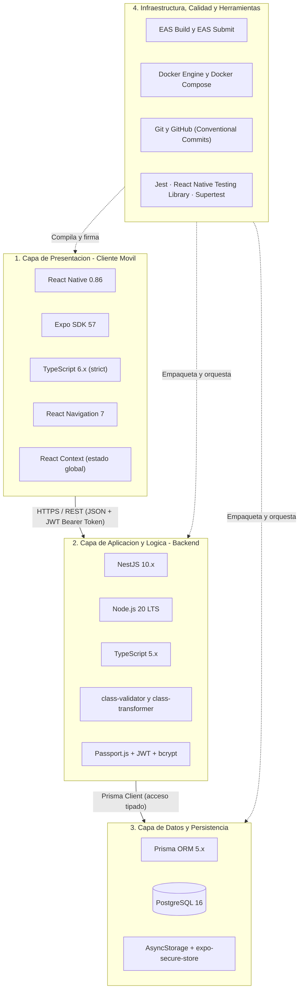
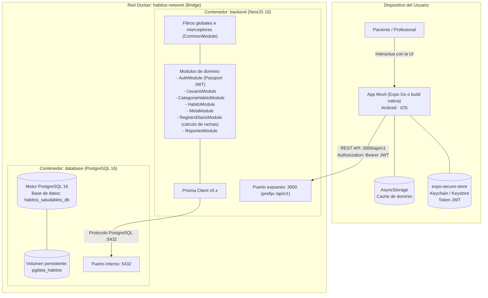

# Selección y Decisión del Stack Tecnológico (HU-01)

> **Historia de Usuario:** HU-01 — Selección de Stack Tecnológico
> **Proyecto:** Sistema de Seguimiento de Hábitos Saludables
> **Institución:** Corporación Universitaria del Huila (CORHUILA) — Neiva, Colombia
> **Programa:** Ingeniería de Sistemas · Asignatura: Programación Móvil
> **Periodo / Grupo:** 2026-B · Grupo 1 (`programacion-movil-2026-b-g1`)
> **Equipo Desarrollador:** Juan José Horta Vanegas & Javier Esteban Ortiz López
> **Docente Tutor:** Ing. Jesús Ariel González Bonilla
> **Fecha de Emisión:** 2026-09-06 · **Revisión:** 2026-09-17 · **Estado:** Aprobado / Consolidado

> ### 📝 Nota de revisión (2026-09-17)
> La versión original de este documento definía un cliente **web** con Next.js 14. Al consolidar
> el alcance de la asignatura, el cliente oficial del sistema pasó a ser una **aplicación móvil
> multiplataforma (React Native + Expo)**. Las secciones 2.1, 3, 4 y 6 se reemplazaron en
> consecuencia; las decisiones de backend y persistencia se mantienen sin cambios. La decisión
> quedó registrada formalmente en
> [ADR-002](../01-architecture/decisions/records/ADR-002-react-native-expo.md).

---

## 1. Introducción y Contexto de la Decisión

El **Sistema de Seguimiento de Hábitos Saludables** es una plataforma diseñada para centros de
bienestar integral. Permite a los usuarios registrar diariamente el cumplimiento de hábitos
(hidratación, ejercicio, alimentación, sueño y meditación), calcular de forma automática rachas
consecutivas de éxito, evaluar metas cuantitativas y permitir que profesionales de la salud
monitoreen el progreso mediante reportes analíticos por fechas.

El sistema se compone de **dos piezas**:

1. **Un cliente móvil**, que es donde la persona registra su cumplimiento en el momento y en el
   lugar en que ocurre. Es el foco de la asignatura y el producto que se entrega.
2. **Un backend REST**, que custodia los datos, impone las reglas de negocio y sirve los reportes.

Para garantizar la estabilidad, la escalabilidad, la facilidad de mantenimiento y el cumplimiento
de los objetivos académicos de cada corte, el equipo realizó un proceso formal de evaluación y
selección del stack tecnológico de ambas piezas.

---

## 2. Investigación y Comparación de Alternativas

### 2.1 Comparativa de Tecnologías del Cliente Móvil

Se evaluaron cuatro alternativas para construir la aplicación móvil:

| Criterio | Alt. 1: React Native + Expo (TypeScript) | Alt. 2: React Native CLI (TypeScript) | Alt. 3: Flutter 3 (Dart) | Alt. 4: Nativo Kotlin + Swift |
|---|---|---|---|---|
| **Bases de código** | **Una sola** para Android, iOS y web | Una sola para Android e iOS | Una sola para Android e iOS | **Dos**, una por plataforma |
| **Requiere macOS para iOS** | **No** — los builds se hacen en la nube con EAS Build | **Sí**, obligatorio para compilar y firmar | **Sí**, obligatorio | **Sí**, obligatorio |
| **Lenguaje** | **TypeScript**, el mismo del backend NestJS | TypeScript | Dart: segundo lenguaje que aprender | Kotlin y Swift: dos lenguajes más |
| **Tipos compartidos con el backend** | **Sí**, `src/types/index.ts` refleja el `schema.prisma` | Sí | No: hay que redefinir el modelo en Dart | No: hay que redefinirlo dos veces |
| **Ciclo de retroalimentación** | **Inmediato**: Expo Go abre la app escaneando un QR | Recarga rápida, pero con compilación nativa previa | Recarga en caliente muy buena | Compilación nativa completa |
| **Configuración del entorno** | **Mínima**: `npm install` y a correr | Gradle y CocoaPods a mano | Instalar el SDK de Flutter, Android Studio y Xcode | La más pesada de todas |
| **Coste de actualizar** | `npx expo install --fix` realinea todo | Cada actualización toca Gradle y CocoaPods | Moderado | Alto, y duplicado |
| **Rendimiento** | Bueno; suficiente para listas y gráficas simples | Bueno | **El mejor** de las multiplataforma | **El máximo posible** |
| **Acceso a APIs nativas** | Amplio vía el SDK de Expo; fuera de él requiere *development build* | Total | Total vía plugins | Total y directo |
| **Tamaño del binario** | El más pesado de los cuatro | Menor que Expo | Moderado | El más liviano |

**Evaluación del cliente móvil:**
**React Native + Expo** es la única alternativa que elimina los dos obstáculos reales del equipo:
la necesidad de macOS —que ninguno de los dos integrantes tiene— y el tiempo de configuración del
entorno nativo, que saldría directamente del presupuesto de las funcionalidades. Además mantiene
la sinergia lingüística con el backend: TypeScript de extremo a extremo.

El sacrificio aceptado es el tamaño del binario y la dependencia del ciclo de versiones del SDK
de Expo. Ambos son asumibles para el alcance del proyecto.

> Análisis completo con sus consecuencias y su umbral de reevaluación:
> [ADR-002](../01-architecture/decisions/records/ADR-002-react-native-expo.md).

---

### 2.2 Comparativa de Tecnologías Backend

Se evaluaron cuatro alternativas para la construcción de la API RESTful:

| Criterio | Alt. 1: NestJS 10 (Node.js + TS) | Alt. 2: Express.js (Node.js + TS) | Alt. 3: Spring Boot 3 (Java 21) | Alt. 4: FastAPI (Python 3.11+) |
|---|---|---|---|---|
| **Paradigma y Arquitectura** | **Arquitectura en capas empresarial** (Controller → Service → Repository), inyección de dependencias modular | Minimalista, sin arquitectura prescrita; requiere estructuración manual | Arquitectura enterprise por excelencia, inyección robusta | ASGI asíncrono, basado en tipos Pydantic |
| **Tipado y Lenguaje** | **TypeScript estricto**, coincidencia 1:1 con el cliente móvil | TypeScript opcional; requiere configuración exhaustiva | Java tipado estático; alto consumo de memoria y sintaxis verbosa | Python con type hints; menor validación en compilación |
| **Validación y DTOs** | **Nativa y declarativa** con `class-validator` mediante pipes globales | Manual con middlewares de terceros; mayor fragmentación | Anotaciones `@Valid`, Hibernate Validator | Integrada con esquemas Pydantic |
| **Seguridad y Modularidad** | Guards JWT (`@UseGuards(JwtAuthGuard)`), interceptores y filtros globales | Middlewares manuales por ruta; propenso a olvidos | Spring Security potente pero complejo de configurar | `OAuth2PasswordBearer`, ágil pero disjunto |
| **Consumo de Recursos** | Bajo-moderado; arranque en menos de 2 segundos | Muy bajo, pero sin arquitectura estructurada | Alto: más de 350 MB de RAM en reposo | Bajo, excelente en E/S asíncrona |
| **Productividad del Equipo** | **Máxima**: CLI interactivo, estructura clara y predecible | Moderada: se pierde tiempo definiendo convenciones | Moderada-baja: mucho código repetitivo por entidad | Alta en prototipos, pero rompe la homogeneidad lingüística |

**Evaluación Backend:**
NestJS impone una disciplina de arquitectura en capas exigida por la metodología SDD, garantizando
modularidad, mantenibilidad e inyección de dependencias nativa, y comparte el mismo lenguaje
(TypeScript) que el cliente móvil.

---

### 2.3 Evaluación de Persistencia de Datos (Base de Datos y ORM)

#### A. Motor de base de datos: relacional frente a no relacional

| Criterio | PostgreSQL 16 (Relacional) | MongoDB 7 (NoSQL documental) | MySQL 8.0 (Relacional) |
|---|---|---|---|
| **Modelo de datos del negocio** | **Altamente relacional**: los usuarios tienen hábitos; los hábitos tienen metas y registros | Documental; difícil de modelar sin redundancia o lecturas cruzadas costosas | Relacional estándar con soporte ACID |
| **Integridad referencial** | **Claves foráneas estrictas**, cascadas y `ON DELETE` | Sin claves foráneas nativas; la integridad se maneja en la aplicación | Claves foráneas estándar en InnoDB |
| **Unicidad compuesta** | Soporta índices únicos compuestos exactos: `@@unique([habitoId, fecha])` | Soporta índices compuestos, pero sin integridad referencial | Soporta índices compuestos únicos |
| **Fechas y rachas** | Tipos `DATE` y `TIMESTAMPTZ` precisos; funciones de ventana y agregación temporal | BSON Date; mayor complejidad en rangos de días contiguos | `DATE` y `DATETIME` funcionales |
| **Madurez en contenedores** | Imagen oficial ligera `postgres:16-alpine` | Imagen pesada; requiere réplicas para transacciones complejas | Funcional, algo más pesada que Alpine |

#### B. Herramienta de acceso a datos (ORM)

| Criterio | Prisma ORM 5.x | TypeORM | Sequelize |
|---|---|---|---|
| **Definición de esquema** | **Esquema declarativo único (`schema.prisma`)**, fuente única de verdad | Entidades dispersas en clases con decoradores | Modelos basados en objetos JavaScript |
| **Seguridad de tipos** | **Generación automática de tipos** derivados del esquema | Tipado parcial; relaciones y selects pierden precisión | Tipado débil o forzado a mano |
| **Migraciones** | `prisma migrate dev` crea migraciones SQL versionadas | Manuales o autogeneradas, a menudo inconsistentes | Manuales, sobre esqueletos JS |
| **Rendimiento** | Query Engine en Rust, sin problemas de N+1 | Propenso a carga perezosa e inconsistencias en joins | Moderado; sintaxis compleja en agregaciones |

**Evaluación de Persistencia:**
El dominio exige una base de datos relacional estricta: un usuario posee hábitos, cada hábito
tiene metas, cada registro pertenece a un hábito en una fecha única. PostgreSQL 16 garantiza
consistencia ACID, y Prisma ofrece el mejor tipado estático del ecosistema Node.js.

> **Consecuencia directa en el cliente móvil:** la restricción `@@unique([habitoId, fecha])`
> obligó a decidir cómo representa el cliente una fecha, para que cliente y servidor coincidan
> siempre en qué día es. Ver
> [ADR-003](../01-architecture/decisions/records/ADR-003-fechas-como-texto-iso.md).

---

## 3. Revisión de Compatibilidad con los Requerimientos del Proyecto

| Requerimiento del sistema | Reto técnico | Solución del stack elegido |
|---|---|---|
| **RF-01 / RF-02: Autenticación segura** | Proteger credenciales y sesiones sin estado, en un cliente móvil | `bcrypt` en el servidor + `@nestjs/jwt` con HMAC-SHA256. En el cliente, el token se custodia en `expo-secure-store` (Keychain / Keystore) |
| **RF-06: Registro diario sin duplicados** (la "validación optimista en el cliente" se descartó en [ADR-012](../01-architecture/decisions/records/ADR-012-sin-respuesta-optimista.md); la unicidad la impone el servidor) | Evitar dos registros del mismo hábito en la misma fecha, incluso si el móvil estuvo sin conexión | `@@unique([habitoId, fecha])` en PostgreSQL, más validación optimista en el cliente e idempotencia por `clienteId` al sincronizar |
| **RF-07: Cálculo dinámico de rachas** | Contar días consecutivos hacia atrás, sin desfases de zona horaria entre el móvil y el servidor | Fechas como texto `YYYY-MM-DD` de extremo a extremo; algoritmo determinista en `RegistroDiarioService` y su equivalente puro en `src/utils/racha.ts` |
| **RF-09 / RF-10: Reportes analíticos** | Filtrar por rango de fechas y calcular porcentajes | Consultas con filtros `gte` / `lte` de Prisma, agregación tipada; el cliente solo renderiza |
| **RNF-01: Disponibilidad del backend** | Ejecución reproducible en cualquier entorno | `docker-compose.yml` multi-contenedor con healthchecks y volumen persistente |
| **RNF-02: Uso móvil en contexto real** | La persona registra su hábito en el gimnasio o antes de dormir, con mala conectividad | Cliente móvil con estrategia offline-first para el registro diario, y caché local de lectura |
| **RNF-03: Entrega multiplataforma sin macOS** | El equipo no dispone de hardware Apple | Expo + EAS Build: los binarios de iOS se compilan y firman en la nube |
| **RNF-04: Demostración académica** | Mostrar la app en dispositivo real en cada revisión de sprint | Expo Go: se abre escaneando un QR, sin instalar nada ni compilar |

---

## 4. Definición del Stack Tecnológico Final

### Tabla resumen del stack oficial

| Capa / Componente | Tecnología | Versión | Rol y justificación principal |
|---|---|---|---|
| **Framework del cliente** | **React Native** | 0.86 | Interfaz nativa para Android e iOS desde una sola base de código |
| **Plataforma de desarrollo** | **Expo** | SDK 57 | Flujo gestionado, Expo Go para demos, EAS Build para compilar iOS sin macOS |
| **Navegación** | **React Navigation** | 7.x | Stack raíz y pestañas inferiores, con rutas tipadas |
| **Estado global del cliente** | **React Context + useState** | — | Sin dependencias; suficiente para 5 entidades ([ADR-001](../01-architecture/decisions/records/ADR-001-state-management-pattern.md)) |
| **Persistencia local** | **AsyncStorage + expo-secure-store** | — | Caché de dominio y custodia cifrada del token ([ADR-004](../01-architecture/decisions/records/ADR-004-persistencia-local.md)) |
| **Framework del backend** | **NestJS** | 10.x | Arquitectura en capas estricta con inyección de dependencias |
| **Runtime del servidor** | **Node.js** | 20 LTS | Ejecución asíncrona de alto rendimiento |
| **Lenguaje común** | **TypeScript** | 5.x / 6.x | Tipado estático riguroso en cliente y servidor |
| **Seguridad y cifrado** | **JWT + bcrypt** | — | Tokens firmados sin estado y hash unidireccional con sal |
| **Validación DTO** | **class-validator** | 0.14+ | Decoradores declarativos para validar entradas HTTP |
| **Motor de base de datos** | **PostgreSQL** | 16-alpine | ACID, índices únicos compuestos e integridad referencial |
| **ORM** | **Prisma** | 5.x | Modelado declarativo, tipos autogenerados y migraciones versionadas |
| **Contenerización del backend** | **Docker y Compose** | 24+ | Despliegue reproducible con un solo comando |
| **Build y distribución del móvil** | **EAS Build / EAS Submit** | — | Compilación y firma en la nube para Android e iOS |
| **Pruebas** | **Jest · RNTL · Supertest** | 29+ | Unitarias del cliente, de componente y E2E del API ([ADR-006](../01-architecture/decisions/records/ADR-006-estrategia-de-pruebas.md)) |
| **Control de versiones** | **Git y GitHub** | — | Ramas, PRs y Conventional Commits |

> ⚠️ **Estado en la v1.0.0 (primer avance del proyecto):** El estado global opera en memoria mediante `React Context`
> (`src/context/AppContext.tsx`) inicializado con datos demo (`src/constants/mockData.ts`). Las librerías de
> persistencia física (`@react-native-async-storage/async-storage` y `expo-secure-store`) y el cliente HTTP
> están ratificados y especificados arquitectónicamente para la fase de integración con el backend NestJS.
>
> **Estado en el corte 3 (2026-10-28):** el stack está implementado completo en cuatro repositorios
> (ADR-010): AsyncStorage (caché y cola sin conexión) y `expo-secure-store` (token) en uso, cliente HTTP
> `apiFetch` contra la API NestJS + Prisma + PostgreSQL desplegada con Docker Compose. Ya no hay datos demo.

---

## 5. Justificación Técnica y de Equipo

### 5.1 Sinergia lingüística de extremo a extremo (TypeScript)

Al emplear TypeScript tanto en el cliente móvil como en el backend:

- Se unifican los tipos de dominio: `Usuario`, `Habito`, `Meta`, `RegistroDiario` y `Racha` tienen
  la misma semántica en ambos lados. `src/types/index.ts` es un espejo del `schema.prisma`.
- Se elimina el coste de cambio de contexto mental entre los dos desarrolladores, maximizando la
  velocidad de entrega en un equipo de dos integrantes.
- Las discrepancias de contrato se detectan en tiempo de compilación, antes de llegar a pruebas.

Flutter habría ofrecido mejor rendimiento, pero a costa de romper esta propiedad: el modelo de
dominio habría tenido que reescribirse en Dart y mantenerse sincronizado a mano.

### 5.2 Viabilidad real del equipo, no solo idoneidad técnica

Ninguno de los dos integrantes dispone de macOS. Eso convierte a React Native CLI, Flutter y el
desarrollo nativo en alternativas **inviables para iOS**, por buenas que sean sobre el papel. Expo
resuelve esa restricción compilando y firmando en la nube. Esta fue la razón decisiva de la
sección 2.1.

### 5.3 Arquitectura orientada a buenas prácticas

En el **backend**, NestJS separa con claridad: los *controllers* solo reciben peticiones HTTP; los
*services* concentran las reglas de negocio; los *repositories* abstraen el acceso a datos; y el
*common module* homogeneiza respuestas y errores.

En el **cliente**, la misma disciplina se aplica sin carpetas equivalentes: las pantallas solo
renderizan y validan formularios, el `AppContext` concentra las invariantes del dominio, y las
funciones puras de `utils/` no importan nada de React. La justificación de esta forma concreta
está en [ADR-007](../01-architecture/decisions/records/ADR-007-estructura-por-rol-tecnico.md).

### 5.4 Integridad de datos e invariantes críticas

La credibilidad del producto depende de la precisión de las rachas. PostgreSQL previene duplicados
y anomalías de concurrencia con `@@unique([habitoId, fecha])`, y Prisma garantiza que ninguna
consulta compile con nombres de columna inexistentes.

**Las mismas cuatro invariantes están implementadas en el cliente**, para dar respuesta inmediata
sin esperar al servidor: registro único por hábito y fecha, meta activa única por hábito, hábito
con registros no eliminable, y `metaCumplida` calculada contra la meta activa. El servidor sigue
siendo la autoridad; el cliente solo se adelanta.

### 5.5 Reproducibilidad y facilidad de demostración

Para las sustentaciones, Docker Compose levanta backend y base de datos igual en cualquier sistema
operativo, y Expo Go abre la app en el teléfono del sustentante escaneando un QR, sin instalar ni
compilar nada. Esto hace que la demo en dispositivo real sea el modo normal de revisar el trabajo,
y no una excepción.

---

## 6. Diagrama de Arquitectura Tecnológica Detallada

> **Nota de red para desarrollo:** en Android, `localhost` apunta al propio dispositivo, no al PC
> del equipo. La URL base se configura por entorno mediante `EXPO_PUBLIC_API_URL`
> (`http://10.0.2.2:3000/api/v1` en el emulador de Android Studio, o la IP de la máquina en un teléfono
> físico). Ver [`../03-api-and-data/api-networking.md`](../03-api-and-data/api-networking.md).

---

## 7. Criterios de Aceptación y Checklist de Verificación (HU-01)

| Criterio de aceptación (HU-01) | Estado | Evidencia documental |
|---|---|---|
| **Comparar al menos 2 alternativas de cliente (framework + lenguaje)** | ✅ Cumplido | Sección 2.1: React Native + Expo, React Native CLI, Flutter 3 y nativo Kotlin/Swift |
| **Comparar al menos 2 alternativas de backend (framework + lenguaje)** | ✅ Cumplido | Sección 2.2: NestJS 10, Express.js, Spring Boot 3 y FastAPI |
| **Evaluar opciones de base de datos (relacional vs no relacional)** | ✅ Cumplido | Sección 2.3: PostgreSQL 16, MongoDB 7 y MySQL 8.0, más comparativa de ORMs |
| **Revisar compatibilidad del stack con los requerimientos del proyecto** | ✅ Cumplido | Sección 3: matriz de 8 requerimientos, incluidos los específicos del contexto móvil |
| **Definir stack final completo (cliente / backend / BD / herramientas)** | ✅ Cumplido | Sección 4: tabla y diagrama con versiones ratificadas |
| **Justificar la selección con criterios técnicos y de equipo** | ✅ Cumplido | Sección 5: cinco pilares, incluida la viabilidad real del equipo |
| **Crear diagrama de arquitectura tecnológica visible** | ✅ Cumplido | Secciones 4 y 6: diagramas Mermaid de componentes y de despliegue |
| **Registrar la decisión como ADR** | ✅ Cumplido | [ADR-002](../01-architecture/decisions/records/ADR-002-react-native-expo.md), con alternativas y consecuencias |
| **Subir documento de decisión al repositorio de documentación** | ✅ Cumplido | Este documento, en `Project/HU-01.md`, enlazado desde el [README](../README.md) |
| **Todo el equipo conoce y valida el stack elegido** | ✅ Cumplido | Firmado por ambos integrantes (ver cierre) y validado en el issue **HU-01** del repositorio |

---

## 8. Verificación Práctica del Stack Elegido

El stack no se dio por bueno sobre el papel: se verificó ejecutándolo.

| Comprobación | Resultado |
|---|---|
| `npm install` sobre Expo SDK 57 | ✅ Sin errores |
| `npx tsc --noEmit` en modo `strict` | ✅ Sin errores de tipos |
| `npx expo install --check` | ✅ Dependencias alineadas con el SDK |
| `npx expo export --platform android` | ✅ Bundle generado (2 MB) |
| Ejecución en Android físico vía Expo Go | ✅ Verificada |
| Ejecución en navegador (`expo start --web`) | ✅ Verificada |
| Ejecución en iOS | ⚠️ No verificada: el equipo no dispone de dispositivo iOS ni macOS. Se validará con un build de EAS |

---

  <strong>Aprobado por el Equipo de Desarrollo:</strong> 
  <em>Juan José Horta Vanegas &nbsp;·&nbsp; Javier Esteban Ortiz López</em> 
  Corporación Universitaria del Huila (CORHUILA) — Programación Móvil 2026-B · Grupo 1

