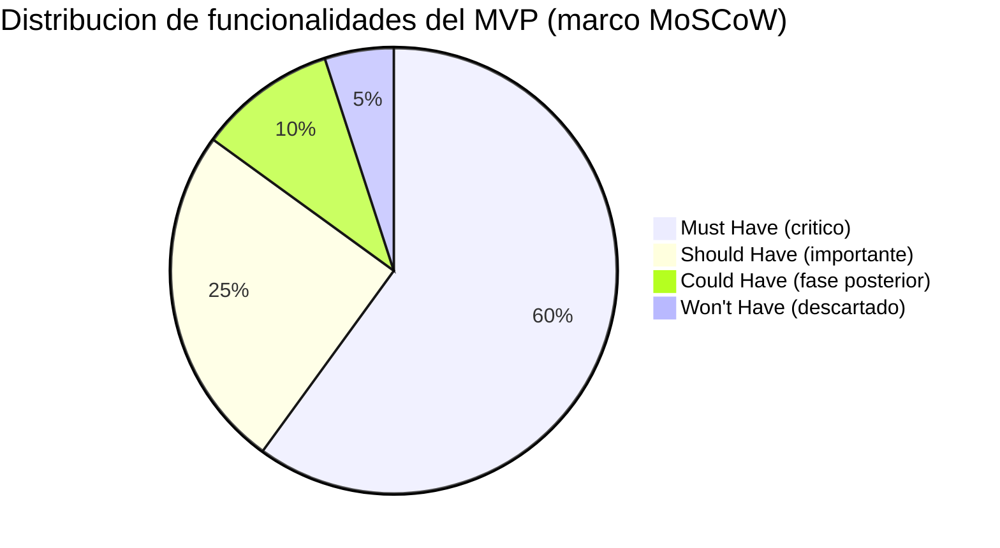
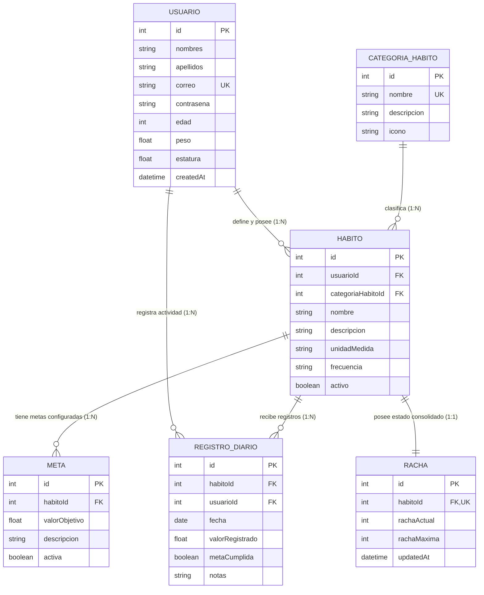
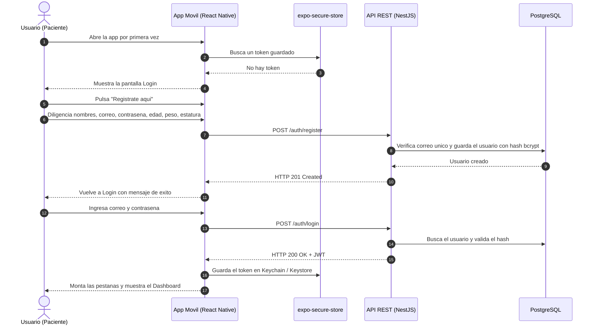
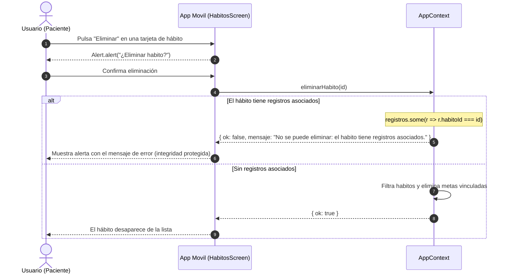
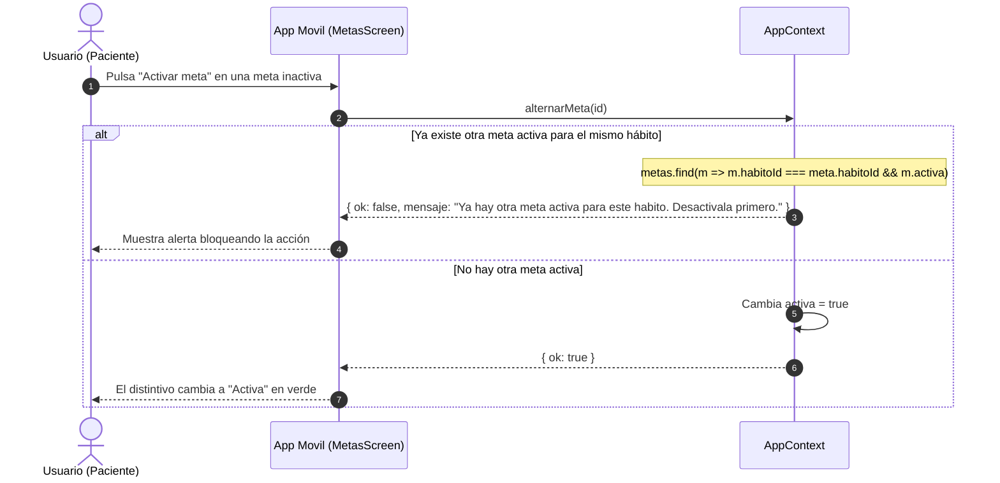
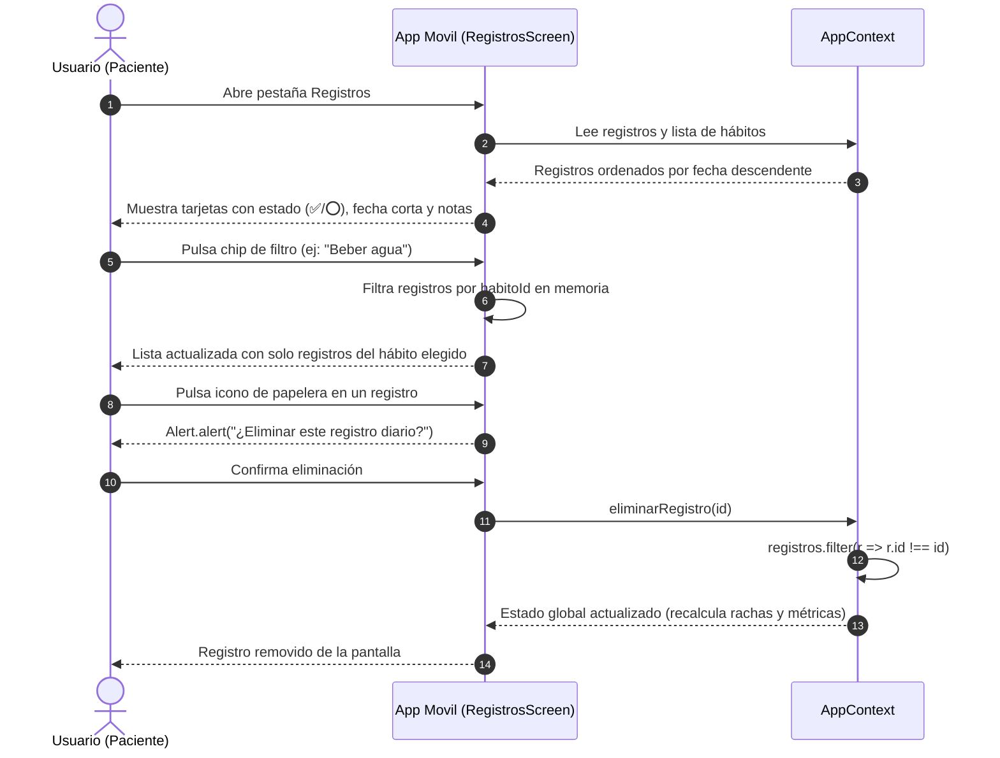
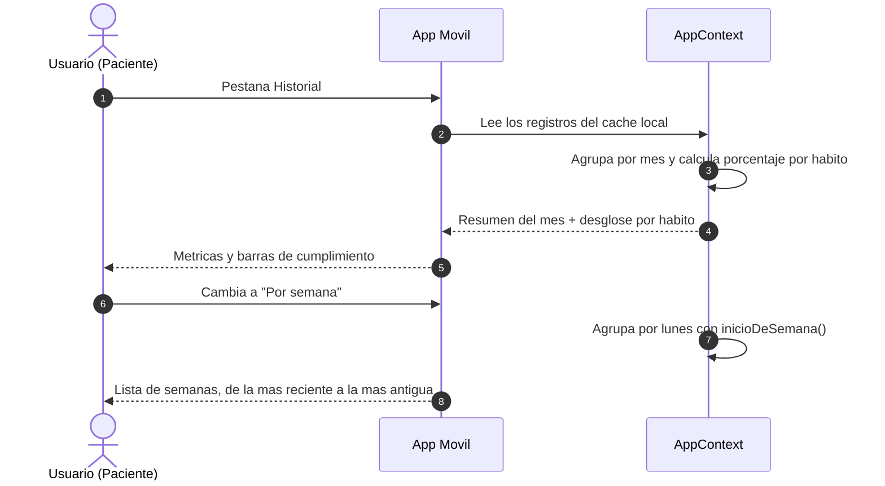
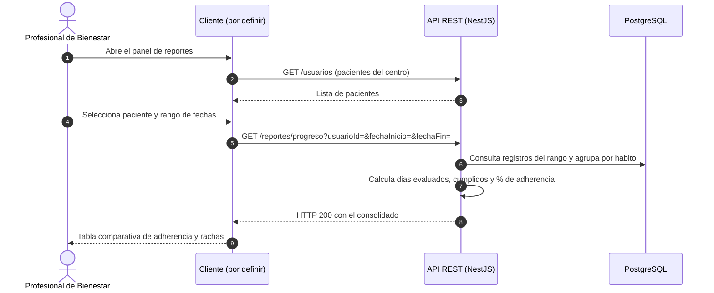

# Discovery del Proyecto: Sistema de Seguimiento de Hábitos Saludables (HU-02)

> **Historia de Usuario:** HU-02 — Discovery del Proyecto
> **Proyecto:** Sistema de Seguimiento de Hábitos Saludables
> **Institución:** Corporación Universitaria del Huila (CORHUILA) — Neiva, Colombia
> **Programa:** Ingeniería de Sistemas · Asignatura: Programación Móvil
> **Periodo / Grupo:** 2026-B · Grupo 1 (`programacion-movil-2026-b-g1`)
> **Equipo Desarrollador:** Juan José Horta Vanegas & Javier Esteban Ortiz López
> **Docente Tutor:** Ing. Jesús Ariel González Bonilla
> **Fecha:** 2026-09-06 · **Revisión:** 2026-09-17 · **Estado:** Aprobado / Consolidado

> ### 📝 Nota de revisión (2026-09-17)
> La versión original de este documento describía el producto como una aplicación **web** y
> listaba las *"aplicaciones nativas móviles"* dentro de **Won't Have**, es decir, fuera del
> alcance. Al consolidarse el alcance de la asignatura, el cliente oficial pasó a ser una
> **aplicación móvil multiplataforma**, lo que contradecía directamente ese apartado.
>
> Se revisaron en consecuencia las secciones 3 (benchmark), 4 (alcance MoSCoW), 5 (wireframes) y
> 7 (flujos de usuario). El planteamiento del problema, las personas objetivo y el modelo de
> datos se mantienen sin cambios: no dependían del canal. La decisión técnica está registrada en
> [ADR-002](../01-architecture/decisions/records/ADR-002-react-native-expo.md).
>
> Además, la sección 4 incorpora ahora una **columna de estado real** por requisito, para que el
> documento refleje lo entregado y no solo lo planificado.

> ### 📝 Nota de revisión (2026-10-25)
> [ADR-008](../01-architecture/decisions/records/ADR-008-reconciliacion-contrato-api.md) ajustó el
> modelo de la sección 6 y los flujos de la sección 7 para la implementación del backend: la racha
> ya **no** es una tabla (se calcula al consultar), `REGISTRO_DIARIO` no lleva `usuarioId` y gana
> `clienteId`, las rutas van en plural (`/registros`) y un hábito con registros se **archiva** en
> lugar de bloquearse. Este documento conserva el diseño aprobado en su momento; donde difiera,
> manda el ADR.

---

## 1. Análisis de Contexto y Planteamiento de la Necesidad

### 1.1 Contexto y Antecedentes

En la sociedad contemporánea, el mantenimiento sostenido de hábitos de vida saludables
(hidratación adecuada, ejercicio físico recurrente, patrones de sueño reparadores, nutrición
consciente y salud mental) constituye uno de los mayores desafíos individuales y de salud
pública. Los centros de bienestar integral y las clínicas de medicina preventiva enfrentan una
problemática recurrente: **la alta tasa de deserción y la falta de constancia de los usuarios**.

Históricamente, los pacientes reciben recomendaciones verbales o folletos impresos en sus
consultas. Sin embargo, al regresar a sus rutinas diarias, la motivación decae progresivamente
por falta de:

1. Mecanismos inmediatos y sin fricción para registrar su actividad diaria.
2. Retroalimentación visual objetiva y estímulos psicológicos positivos (como rachas o
   porcentajes de cumplimiento).
3. Conexión y trazabilidad compartida con los profesionales que orientan su proceso de bienestar.

### 1.2 Problema Central

> *La desconexión informativa entre las indicaciones prescritas en el centro de bienestar y la
> ejecución real cotidiana del paciente, agravada por la ineficiencia de métodos manuales o no
> estructurados (libretas, notas dispersas en el móvil), lo que genera abandono prematuro de
> hábitos y priva al profesional de salud de datos cuantitativos para un acompañamiento efectivo.*

### 1.3 Por qué el canal es el móvil

El punto 1 del apartado anterior —*registrar sin fricción*— determina el canal del producto. El
cumplimiento de un hábito ocurre **en el momento y en el lugar** en que sucede: saliendo a
caminar, en el gimnasio, antes de dormir. Si registrarlo exige sentarse ante un computador y
abrir un navegador, el registro se pospone, y lo pospuesto se olvida.

El teléfono es el único dispositivo que la persona lleva encima en todos esos momentos. De ahí
que el cliente oficial del sistema sea una aplicación móvil, y que el objetivo de diseño sea que
registrar un cumplimiento tome **menos de 10 segundos** desde que se abre la app.

---

## 2. Identificación de Usuarios Objetivo (User Personas)

Se identificaron tres arquetipos principales de usuarios que interactúan con la plataforma.

---

### Persona 1: Carlos Gómez (el paciente en formación de hábitos)

```
┌─────────────────────────────────────────────────────────────────────────────┐
│  CARLOS GOMEZ · 28 ANOS · DISENADOR GRAFICO FREELANCE                       │
├─────────────────────────────────────────────────────────────────────────────┤
│ Perfil: Trabaja remotamente frente al computador mas de 9 horas diarias.     │
│ Experimenta sedentarismo, fatiga ocular, deshidratacion y sueno irregular.   │
│ Acude al centro de bienestar por recomendacion medica.                       │
│                                                                              │
│  Metas y motivaciones:                                                       │
│  - Tomar al menos 2 litros de agua diarios durante su jornada.               │
│  - Realizar 30 minutos de actividad fisica al menos 5 dias a la semana.      │
│  - Ver de forma clara si esta manteniendo la constancia dia tras dia.        │
│                                                                              │
│  Dolores y frustraciones:                                                    │
│  - Se le olvida registrar lo que hace si las aplicaciones son complejas.     │
│  - Las apps que uso tenian demasiada publicidad o cobros ocultos.            │
│  - Pierde la motivacion si no ve un indicador de progreso continuo (racha).  │
│                                                                              │
│  Necesidad en el sistema:                                                    │
│  Una app en su telefono, rapida de abrir, donde en menos de 10 segundos      │
│  pueda marcar su cumplimiento diario y ver crecer su racha personal.         │
└─────────────────────────────────────────────────────────────────────────────┘
```

> **Implicación de diseño:** Carlos es la razón de que el registro diario sea la única operación
> con estrategia **offline-first**. Registra su caminata en el parque, donde la conexión es mala.
> Si la app le falla ahí, la desinstala.

---

### Persona 2: Dra. Laura Martínez (la profesional de bienestar)

```
┌─────────────────────────────────────────────────────────────────────────────┐
│  DRA. LAURA MARTINEZ · 36 ANOS · NUTRICIONISTA Y COACH DE SALUD             │
├─────────────────────────────────────────────────────────────────────────────┤
│ Perfil: Atiende mas de 30 pacientes semanales en el centro de bienestar.     │
│ Prescribe planes de hidratacion, alimentacion y rutinas de movimiento.       │
│                                                                              │
│  Metas y motivaciones:                                                       │
│  - Monitorear si sus pacientes realmente aplican el plan acordado.           │
│  - Detectar caidas drasticas en el cumplimiento antes de la cita mensual.    │
│  - Contar con reportes tabulares y porcentajes de adherencia objetivos.      │
│                                                                              │
│  Dolores y frustraciones:                                                    │
│  - Los pacientes dicen "creo que tome agua casi todos los dias", sin datos.  │
│  - Pierde tiempo de consulta recopilando informacion retrospectiva.          │
│  - No puede comparar el progreso entre rangos de fechas especificos.         │
│                                                                              │
│  Necesidad en el sistema:                                                    │
│  Un panel donde seleccione un paciente, elija un rango de fechas y vea la    │
│  tasa de cumplimiento, los dias cumplidos y la racha maxima.                 │
└─────────────────────────────────────────────────────────────────────────────┘
```

> **Estado real:** el panel del profesional **no está implementado en la v1.0.0**. Requiere
> backend y un rol de usuario distinto. Es la brecha más grande entre lo planificado en este
> documento y lo entregado, y está declarada como tal en la sección 4 y en
> [feature-historial.md](../01-architecture/features/feature-historial.md).

---

### Persona 3: Roberto Morales (el administrador del centro)

```
┌─────────────────────────────────────────────────────────────────────────────┐
│  ROBERTO MORALES · 45 ANOS · COORDINADOR OPERATIVO DEL CENTRO               │
├─────────────────────────────────────────────────────────────────────────────┤
│ Perfil: Vela por la calidad del servicio, la satisfaccion de los clientes    │
│ y la consistencia metodologica del centro de bienestar.                      │
│                                                                              │
│  Metas y motivaciones:                                                       │
│  - Estandarizar las categorias de habitos ofrecidas en el centro.            │
│  - Asegurar que el sistema sea estable, seguro y mantenga la privacidad.     │
│                                                                              │
│  Dolores y frustraciones:                                                    │
│  - Desorden si cada profesional crea clasificaciones arbitrarias sin norma.  │
│  - Depender de plataformas externas con costos mensuales por usuario.        │
└─────────────────────────────────────────────────────────────────────────────┘
```

> **Estado real:** el catálogo de categorías existe y es **de solo lectura para el paciente**
> (5 categorías maestras), que es la parte de la necesidad de Roberto que sí se cumple. La
> pantalla de administración del catálogo no está implementada.

---

## 3. Investigación de Soluciones Similares en el Mercado (Benchmark Competitivo)

Se analizaron las aplicaciones de hábitos y bienestar más populares del mercado. Todas ellas son,
significativamente, **aplicaciones móviles**: es el canal natural de esta categoría de producto.

| Solución analizada | Fortalezas | Debilidades / brechas | Comparación con nuestro sistema |
|---|---|---|---|
| **Habitica** | Gamificación extrema con personajes de rol, recompensas, niveles y gremios sociales | Excesivamente lúdica; distrae del foco de salud; sin conexión con profesionales clínicos ni datos antropométricos | Nuestro sistema tiene un **enfoque clínico y de bienestar integral**, formal y directo, con métricas de salud y sin distracciones de videojuego |
| **Streaks** (iOS) | Interfaz minimalista excelente, cálculo de rachas impecable, sincronización con Apple Health | **Exclusivo del ecosistema Apple**, de pago obligatorio y de uso puramente individual, sin ningún soporte clínico | Nuestro sistema es **multiplataforma (Android e iOS desde una sola base de código)**, gratuito para el paciente del centro y con soporte multiusuario |
| **Fabulous** | Respaldada por investigación de comportamiento; onboarding guiado profundo | Suscripción premium costosa; flujos rígidos que imponen rutinas prefabricadas sin adaptación libre | Nuestro sistema ofrece **metas personalizadas y flexibles** por paciente, definidas junto a su profesional |
| **MyFitnessPal** | Base de datos nutricional masiva y escaneo de códigos de barras | Saturada de publicidad intrusiva en su versión gratuita; complejidad abrumadora; **descuida** hábitos como sueño, agua y meditación | Nuestro sistema abarca los **5 pilares de bienestar holístico** (hidratación, ejercicio, alimentación, sueño, meditación) en una experiencia limpia |
| **Plantillas de Notion / Google Sheets** | Alta personalización visual; bajo costo inicial | Registro 100 % manual, sin validaciones de integridad, sin alertas de unicidad, sin cálculo de rachas dinámico ni API | Nuestro sistema tiene **motor relacional PostgreSQL con restricciones ACID**, cálculo algorítmico de rachas y API tipada |

### Matriz de diferenciación competitiva

```
          [ Alto enfoque clinico / profesional ]
                           │
                           │    NUESTRO SISTEMA
                           │     (Registro movil + rachas + reportes al centro)
                           │
  [ Solo individual ] ─────┼──────────────────────── [ Conexion con el centro ]
                           │
       Streaks             │
       Fabulous            │
       Habitica            │
                           │
         [ Bajo enfoque clinico / solo entretenimiento ]
```

### Qué aprendimos del benchmark y aplicamos al producto

| Observación | Decisión que provocó |
|---|---|
| La racha es el mecanismo de motivación más efectivo (Streaks lo demuestra) | La racha es una métrica de primer nivel: aparece en el dashboard y en cada tarjeta de hábito |
| La gamificación excesiva distrae del objetivo de salud (Habitica) | Sin puntos, sin avatares, sin niveles. Solo el dato y su evolución |
| La publicidad y los cobros ocultos destruyen la confianza (MyFitnessPal) | Sin publicidad, sin analítica de terceros, sin pasarelas de pago dentro del sistema |
| La exclusividad de plataforma excluye usuarios (Streaks solo en iOS) | Multiplataforma desde una sola base de código ([ADR-002](../01-architecture/decisions/records/ADR-002-react-native-expo.md)) |
| Ninguna conecta al paciente con su profesional | Es nuestra diferenciación central, y también nuestra mayor deuda pendiente |

---

## 4. Definición del MVP (Alcance y Priorización MoSCoW)



### 4.1 MUST HAVE — obligatorio e indispensable

| # | Requisito | Estado en la v1.0.0 |
|---|---|---|
| **M-01** | Autenticación segura con JWT, hashing bcrypt y sesiones sin estado | ⚠️ **Interfaz completa, backend pendiente.** Hoy el login acepta cualquier credencial no vacía (hallazgo S-01) |
| **M-02** | Perfil de usuario con datos antropométricos iniciales (edad, peso, estatura) | ⚠️ Se capturan en el alta; no hay pantalla para editarlos después |
| **M-03** | Catálogo maestro de categorías (Hidratación, Ejercicio, Alimentación, Sueño, Meditación) | ✅ **Entregado** (solo lectura para el paciente) |
| **M-04** | CRUD de hábitos vinculados al usuario y a su categoría | ⚠️ **Crear, listar y eliminar entregados.** Falta editar |
| **M-05** | Metas cuantitativas por hábito, con una única meta activa | ✅ **Entregado**, con la invariante validada al crear **y** al reactivar |
| **M-06** | Registro diario con restricción de unicidad (`habitoId + fecha`) | ✅ **Entregado** |
| **M-07** | Cálculo dinámico de racha actual y racha máxima histórica | ✅ **Entregado** (`src/utils/racha.ts`) |
| **M-08** | Pantalla principal con métricas del día, gráfica semanal y rachas | ✅ **Entregado** |
| **M-09** | Panel de reportes por rango de fechas para el seguimiento profesional | ❌ **No entregado.** Requiere backend y un rol de usuario distinto |
| **M-10** | Backend desplegado con Docker Compose | ❌ **No entregado.** Siguiente iteración |
| **M-11** | Aplicación móvil funcional en Android e iOS desde una sola base de código | ✅ **Entregado** (verificado en Android y web; iOS pendiente de build de EAS) |
| **M-12** | Pestaña y listado cronológico de registros con filtro interactivo por hábito y eliminación individual | ✅ **Entregado** (`src/screens/RegistrosScreen.tsx`) |

> **Estado en el corte 3 (2026-10-28):** todos los requisitos de esta tabla están entregados.
> La columna de arriba conserva el estado de la v1.0.0; el estado vigente, requisito por requisito,
> está en la [matriz de trazabilidad](./README.md).

> **M-11 y M-12 son adiciones clave de esta revisión.** En la versión original no existían porque
> el producto se concebía como web. M-11 es el requisito central de la asignatura y M-12 consolida
> la vista detallada de registros diarios en el cliente móvil.

### 4.2 SHOULD HAVE — altamente recomendado

| # | Requisito | Estado en la v1.0.0 |
|---|---|---|
| **S-01** | Resumen semanal visual con indicadores porcentuales de adherencia | ✅ **Entregado** (`WeekChart` en el dashboard) |
| **S-02** | Historial mensual con desglose por hábito | ✅ **Entregado** (mensual y semanal) |
| **S-03** | Respuestas HTTP normalizadas con interceptor y filtros globales de excepción | ❌ Pendiente: depende del backend |
| **S-04** | Validación declarativa con DTOs que rechace campos no permitidos | ❌ Pendiente: depende del backend |
| **S-05** | Persistencia local para que los datos sobrevivan al cierre de la app | ❌ **Pendiente.** Decidido en [ADR-004](../01-architecture/decisions/records/ADR-004-persistencia-local.md) |
| **S-06** | Registro diario funcional sin conexión | ❌ **Pendiente.** Estrategia en [`../03-api-and-data/offline-sync.md`](../03-api-and-data/offline-sync.md) |

> **Estado en el corte 3 (2026-10-28):** todos los requisitos de esta tabla están entregados.
> La columna de arriba conserva el estado de la v1.0.0; el estado vigente, requisito por requisito,
> está en la [matriz de trazabilidad](./README.md).

> **S-05 y S-06 son nuevos en esta revisión**, y son consecuencia directa del canal móvil: en una
> web, cerrar la pestaña sin perder datos y funcionar sin conexión no son requisitos evidentes;
> en un teléfono, lo son.

### 4.3 COULD HAVE — deseable para versiones futuras

- **C-01:** Exportación de reportes clínicos a PDF descargable.
- **C-02:** **Recordatorios diarios mediante notificaciones push** (`expo-notifications`). En la
  versión web original esto era una alerta del navegador, de alcance muy limitado; en móvil es
  una notificación real y es la funcionalidad con mayor impacto potencial en la retención.
- **C-03:** Gráficas interactivas con una librería de visualización.
- **C-04:** Edición de hábitos, metas y registros ya creados.
- **C-05:** Widget de pantalla de inicio para registrar sin abrir la app.

### 4.4 WON'T HAVE — explícitamente fuera del alcance

Para asegurar la entrega puntual del MVP y mantener el foco en la calidad de la arquitectura:

- ❌ **Integración con wearables** (Apple Watch, Garmin, Fitbit): el registro es manual.
- ❌ **Pasarelas de pago o facturación electrónica:** no se cobra dentro del sistema.
- ❌ **Notificaciones por SMS o WhatsApp:** no se integran proveedores externos de mensajería.
- ❌ **Chat en vivo o videollamadas:** la interacción clínica es asíncrona, mediante reportes.
- ❌ **Modo sin conexión para la autenticación:** iniciar sesión siempre requiere red.

> **Cambio respecto de la versión original:** este apartado incluía *"Aplicaciones nativas
> móviles (iOS / Android): la aplicación es 100 % responsiva vía web"*. Esa línea se elimina,
> porque contradice el producto que efectivamente se construyó. La aplicación móvil dejó de ser
> un descarte para convertirse en **M-11**, el requisito central del proyecto.

---

## 5. Diseño Inicial: Wireframes de las Pantallas Principales

Los wireframes se rehicieron para pantalla de teléfono (vertical, ~390 × 844 pt). La app tiene
**8 pantallas**: dos de autenticación, cinco pestañas y un modal.

### 5.1 Autenticación (`Login` y `Registro`)

#### 5.1.1 Inicio de sesión (`LoginScreen`)

```
┌────────────────────────────────┐
│                                │
│              🌱                │
│      Habitos Saludables        │
│  Tu progreso diario, en un     │
│        solo lugar              │
│                                │
│ ┌────────────────────────────┐ │
│ │ CORREO                     │ │
│ │ [ tu@correo.com          ] │ │
│ │                            │ │
│ │ CONTRASENA                 │ │
│ │ [ ••••••••               ] │ │
│ │                            │ │
│ │ [    Iniciar sesion      ] │ │
│ │ ────────────────────────── │ │
│ │  ¿No tienes cuenta?        │ │
│ │  Registrate aqui           │ │
│ └────────────────────────────┘ │
└────────────────────────────────┘
```

#### 5.1.2 Registro de usuario (`RegisterScreen`)

```
┌────────────────────────────────┐
│                                │
│              🌱                │
│         Crear cuenta           │
│  Empieza a registrar tus       │
│           habitos              │
│                                │
│ ┌────────────────────────────┐ │
│ │ Nombres * [ Juan Jose    ] │ │
│ │ Apellidos [ Horta Vanegas] │ │
│ │ Correo *  [ tu@correo.com] │ │
│ │ Contraseña * [ ••••••••  ] │ │
│ │ Edad      [ 22           ] │ │
│ │ Peso (kg) [ 70           ] │ │
│ │ Estatura (m) [ 1.75      ] │ │
│ │                            │ │
│ │ [     Crear cuenta       ] │ │
│ │ ────────────────────────── │ │
│ │  ¿Ya tienes cuenta?        │ │
│ │  Inicia sesion             │ │
│ └────────────────────────────┘ │
└────────────────────────────────┘
```

### 5.2 Dashboard — pestaña Inicio

```
┌────────────────────────────────┐
│ Hola, Juan Jose                │
│ 17 de septiembre de 2026    [⏻]│
│                                │
│ ┌─────────────┐ ┌────────────┐ │
│ │ 📌    4     │ │ ✅   2/4   │ │
│ │ Habitos     │ │ Registrados│ │
│ │ activos     │ │ hoy        │ │
│ └─────────────┘ └────────────┘ │
│ ┌─────────────┐ ┌────────────┐ │
│ │ 🔥    5     │ │ 📊   78%   │ │
│ │ Mejor racha │ │ Semana     │ │
│ └─────────────┘ └────────────┘ │
│                                │
│ ┌────────────────────────────┐ │
│ │ Actividad de la semana     │ │
│ │  67% 100% 50%  -  80% ...  │ │
│ │  ▆▆  ███  ▃▃   ▁  ██   ..  │ │
│ │ Lun Mar Mie Jue Vie Sab Dom│ │
│ └────────────────────────────┘ │
│                                │
│ ┌────────────────────────────┐ │
│ │ Registros de hoy           │ │
│ │ Beber agua   9 vasos   ✅  │ │
│ │ Caminar     35 minutos ✅  │ │
│ └────────────────────────────┘ │
│                                │
│ [ + Registrar cumplimiento ]   │
├────────────────────────────────┤
│  🏠    📌    🎯    📋    📊   │
│ Inicio Habit Metas Regis Histo │
└────────────────────────────────┘
```

### 5.3 Nuevo registro — modal

```
┌────────────────────────────────┐
│ Nuevo registro             [×] │
├────────────────────────────────┤
│ HABITO                         │
│ (Beber agua) (Caminar) (Dor... │  ← chips con scroll horizontal
│                                │
│ FECHA                          │
│ [ ◀ ]  17 de septiembre  [ ▶ ] │  ← ▶ bloqueada en la fecha de hoy
│                                │
│ Meta activa: 8 vasos           │
│                                │
│ VALOR (vasos)                  │
│ [ 9                          ] │
│                                │
│ NOTAS (opcional)               │
│ [                            ] │
│                                │
│ ┌──────────────┐┌────────────┐ │
│ │  Cancelar    ││  Guardar   │ │
│ └──────────────┘└────────────┘ │
└────────────────────────────────┘
```

> Diferencia clave respecto del wireframe web original: no hay `<select>` desplegable ni campo de
> fecha de texto libre. El hábito se elige con chips y la fecha con flechas de día, porque ambos
> patrones se manejan con el pulgar y sin teclado. Ver
> [`../01-architecture/screens/screen-nuevo-registro.md`](../01-architecture/screens/screen-nuevo-registro.md).

### 5.4 Historial — pestaña

```
┌────────────────────────────────┐
│ Historial                      │
│ ┌────────────┬───────────────┐ │
│ │ Por mes  ● │  Por semana   │ │  ← SegmentedTabs
│ └────────────┴───────────────┘ │
│ Ene Feb Mar ... (Sep) Oct Nov  │  ← scroll horizontal de meses
│                                │
│  Registros: 34   Cumplidas: 27 │
│  Adherencia: 79%               │
│                                │
│ ┌────────────────────────────┐ │
│ │ Beber agua                 │ │
│ │ 12 de 14 · 86% · prom. 8.2 │ │
│ │ ████████████████░░░        │ │
│ ├────────────────────────────┤ │
│ │ Caminar                    │ │
│ │ 9 de 13 · 69% · prom. 31.4 │ │
│ │ █████████████░░░░░░        │ │
│ └────────────────────────────┘ │
├────────────────────────────────┤
│  🏠    📌    🎯    📋    📊   │
└────────────────────────────────┘
```

### 5.5 Hábitos — pestaña y modal (`HabitosScreen`)

```
┌────────────────────────────────┐
│ 📌 Habitos                 [+] │
│ 4 habitos registrados          │
│                                │
│ ┌────────────────────────────┐ │
│ │ 💧 Beber agua              │ │
│ │ Mantener la hidratacion... │ │
│ │ Unidad: vasos              │ │
│ │ 🔥 Racha actual: 5 días    │ │
│ │ 🏆 Racha récord: 7 días    │ │
│ │ 🎯 Meta activa: 8 vasos    │ │
│ │                   [Eliminar]│ │
│ └────────────────────────────┘ │
│ ┌────────────────────────────┐ │
│ │ 🏃 Caminar                 │ │
│ │ Caminata ligera al aire... │ │
│ │ Unidad: minutos            │ │
│ │ 🔥 Racha actual: 3 días    │ │
│ │ 🎯 Meta activa: 30 min     │ │
│ │                   [Eliminar]│ │
│ └────────────────────────────┘ │
├────────────────────────────────┤
│  🏠    📌    🎯    📋    📊   │
│ Inicio Habit Metas Regis Histo │
└────────────────────────────────┘
```

> **Modal nuevo hábito:** se abre con `[+]` y contiene: Nombre (`Input`), Descripción opcional
> (`Input`), Categoría (`ChipSelector`: Hidratación, Ejercicio, Alimentación, Sueño, Meditación),
> Unidad de medida (`Input`: vasos, minutos, horas, etc.) y botones Guardar/Cancelar.

### 5.6 Metas — pestaña y modal (`MetasScreen`)

```
┌────────────────────────────────┐
│ 🎯 Metas                   [+] │
│ 3 activas de 4 totales         │
│                                │
│ ┌────────────────────────────┐ │
│ │ Beber agua        [Activa] │ │
│ │ 8 vasos de agua al dia     │ │
│ │ Objetivo: 8 vasos          │ │
│ │ [ Desactivar meta ]        │ │
│ └────────────────────────────┘ │
│ ┌────────────────────────────┐ │
│ │ Meditar         [Inactiva] │ │
│ │ 10 minutos de meditacion   │ │
│ │ Objetivo: 10 minutos       │ │
│ │ [ Activar meta ]           │ │
│ └────────────────────────────┘ │
├────────────────────────────────┤
│  🏠    📌    🎯    📋    📊   │
│ Inicio Habit Metas Regis Histo │
└────────────────────────────────┘
```

> **Modal nueva meta:** selector de hábito (`ChipSelector`), Valor objetivo numérico (`Input`),
> Descripción cualitativa (`Input`), y validación de meta única activa al guardar.

### 5.7 Registros — pestaña de historial cronológico (`RegistrosScreen`)

```
┌────────────────────────────────┐
│ 📋 Registros               [+] │
│ 14 registros                   │
│                                │
│ FILTRAR POR HABITO             │
│ (Todos) (Beber agua) (Caminar) │ ← scroll horizontal de chips
│                                │
│ ┌────────────────────────────┐ │
│ │ ✅ Beber agua       17 sep │ │
│ │    9 vasos                 │ │
│ │    "Despues de entrenar"   │ │
│ │                        [🗑] │ │
│ ├────────────────────────────┤ │
│ │ ✅ Caminar          17 sep │ │
│ │    35 minutos              │ │
│ │                        [🗑] │ │
│ ├────────────────────────────┤ │
│ │ ⭕ Dormir bien      16 sep │ │
│ │    6 horas                 │ │
│ │                        [🗑] │ │
│ └────────────────────────────┘ │
├────────────────────────────────┤
│  🏠    📌    🎯    📋    📊   │
│ Inicio Habit Metas Regis Histo │
└────────────────────────────────┘
```

### 5.8 Reportes del profesional — **no implementado**

El wireframe original de esta vista (tabla comparativa de adherencia por paciente, con filtro de
rango de fechas) sigue siendo válido como diseño objetivo, pero corresponde a **M-09**, que no se
entrega en la v1.0.0. Requiere backend, un rol de usuario distinto y, probablemente, un canal
distinto: una tabla de 6 columnas para 30 pacientes no cabe cómodamente en un teléfono, y la
profesional la consulta sentada en su consultorio.

> **Decisión pendiente para el próximo corte:** si el panel del profesional es una sexta pestaña
> de esta app, una app aparte, o una vista web. Se resolverá con un ADR.

---

## 6. Modelo de Datos Inicial (Entidades y Relaciones)

El modelo relacional, estructurado en PostgreSQL mediante Prisma ORM, comprende 6 entidades
fuertemente vinculadas.



### Justificación de las relaciones clave

1. **`Usuario 1:N Habito`** — una persona gestiona varios hábitos simultáneos en distintas áreas
   de su vida.
2. **`CategoriaHabito 1:N Habito`** — las categorías son preestablecidas por el centro y agrupan
   hábitos de múltiples usuarios.
3. **`Habito 1:N Meta`** — permite conservar el historial de metas a lo largo del tiempo, pero
   solo **una activa** a la vez por regla de negocio (`activa = true`).
4. **`Habito 1:N RegistroDiario`** — un registro por día de ejecución, protegido por
   `@@unique([habitoId, fecha])`.
5. **`Habito 1:1 Racha`** — cada hábito tiene un registro de racha con su estado actual y su
   récord histórico.

### Cómo se traduce este modelo al cliente móvil

`src/types/index.ts` es un espejo de este diagrama, con **tres diferencias deliberadas**:

| Diferencia | Motivo |
|---|---|
| `Usuario` **no declara `contrasena`** | La contraseña nunca viaja al cliente ni se almacena en el dispositivo |
| `fecha` es `string` (`'YYYY-MM-DD'`), no `Date` | Evita el desfase de un día al mezclar UTC con hora local ([ADR-003](../01-architecture/decisions/records/ADR-003-fechas-como-texto-iso.md)) |
| `Racha` es un **valor derivado**, no una entidad almacenada | El cliente la recalcula con `calcularRacha()` sobre los registros que ya tiene en memoria. El servidor sí la persiste, para no recalcularla en cada consulta |

> La tercera diferencia es la más importante de entender: **ambos cálculos deben dar el mismo
> número**. Cuando exista el API, el valor del servidor es la fuente de verdad y el del cliente
> queda solo para la respuesta optimista mientras llega. Es también la razón por la que el
> algoritmo de rachas es el primer candidato a tener pruebas automatizadas.

> **Nota (2026-10-28, [ADR-012](../01-architecture/decisions/records/ADR-012-sin-respuesta-optimista.md)):** la respuesta optimista se descartó. La app espera la respuesta del servidor y muestra lo que este decidió; sin red, el registro queda *pendiente* (S-06) en vez de darse por hecho.

---

## 7. Flujos de Usuario Principales (User Flows)

### Flujo 1: Registro, autenticación y onboarding



> **Diferencia clave con el flujo web original:** el token **no va a `localStorage`** sino al
> almacenamiento seguro del sistema operativo, y la app comprueba si ya hay sesión **antes** de
> mostrar el login, para no pedir credenciales en cada arranque.

### Flujo 2: Creación de hábito y definición de meta

```mermaid
sequenceDiagram
    autonumber
    actor U as Usuario (Paciente)
    participant APP as App Movil
    participant CTX as AppContext
    participant API as API REST (NestJS)
    participant DB as PostgreSQL

    U->>APP: Pestana Habitos, pulsa "+"
    APP->>CTX: Lee el catalogo de categorias (ya en cache)
    CTX-->>APP: Hidratacion, Ejercicio, Alimentacion, Sueno, Meditacion
    U->>APP: Escribe "Beber agua", elige Hidratacion, unidad "vasos"
    APP->>CTX: crearHabito(datos)
    CTX->>API: POST /habitos (con Bearer JWT)
    API->>DB: Inserta el habito vinculado al usuarioId del token
    DB-->>API: Habito creado (id: 10)
    API-->>CTX: HTTP 201 Created
    CTX-->>APP: Estado actualizado
    APP-->>U: Cierra el modal; la tarjeta aparece en la lista
    U->>APP: Pestana Metas, pulsa "+", elige "Beber agua", objetivo 8
    APP->>CTX: crearMeta(datos)
    Note over CTX: Valida que el habito no tenga ya una meta activa
    CTX->>API: POST /metas
    API-->>CTX: HTTP 201 Created (meta activa)
    APP-->>U: La meta aparece con el distintivo de activa
```

### Flujo 2b: Eliminación protegida de hábito (integridad referencial)



### Flujo 2c: Alternancia y activación controlada de metas (meta única activa)



### Flujo 3: Registro diario y actualización de la racha

```mermaid
sequenceDiagram
    autonumber
    actor U as Usuario (Paciente)
    participant APP as App Movil
    participant CTX as AppContext
    participant API as API REST (NestJS)
    participant DB as PostgreSQL

    U->>APP: Dashboard, pulsa "+ Registrar cumplimiento"
    U->>APP: Elige "Beber agua", fecha de hoy, valor 9
    APP->>CTX: crearRegistro(habitoId, fecha, valor)
    Note over CTX: Valida que no exista ya un registro de ese habito para esa fecha
    Note over CTX: Compara 9 contra la meta activa (8) => metaCumplida = true
    CTX-->>APP: Respuesta optimista: "Registro guardado. Meta cumplida!"
    APP-->>U: Mensaje en verde; el modal se cierra solo

    CTX->>API: POST /registro (habitoId, fecha, valor, clienteId)
    API->>DB: Verifica @@unique([habitoId, fecha])
    API->>DB: Consulta la meta activa del habito
    API->>DB: Guarda el RegistroDiario
    API->>DB: Recalcula y actualiza la tabla Racha
    DB-->>API: Confirmado
    API-->>CTX: HTTP 201 Created (registro + racha del servidor)
    Note over CTX: El valor del servidor reemplaza al calculo optimista
    Note over CTX: Revisado por ADR-012 (2026-10-28): ya no hay respuesta optimista; se espera el 201

    alt Sin conexion
        CTX->>CTX: Encola la mutacion con su clienteId
        APP-->>U: El registro aparece con el distintivo "pendiente de subir"
        Note over CTX: Al recuperar conexion, reenvia la cola en orden
    end
```

> **Diferencia clave con el flujo web original:** el cliente responde **antes** de que el servidor
> conteste. En una web con buena conexión, esperar 200 ms es aceptable; en un teléfono con mala
> señal, esperar 8 segundos hace que la persona pulse dos veces. Por eso el cliente replica las
> invariantes del backend: para poder responder al instante sin arriesgar datos incoherentes.

### Flujo 3b: Visualización, filtrado por hábito y eliminación en pestaña Registros



### Flujo 4: Consulta de progreso



> **Este flujo funciona completamente sin conexión**, porque las agregaciones se calculan sobre
> los registros que ya están en el dispositivo. Es una ventaja directa de mantener el dominio en
> el cliente.

### Flujo 5: Monitoreo clínico por el profesional — **no implementado**



> Corresponde a **M-09**. El cliente aparece como "por definir" a propósito: está pendiente
> decidir si es una pestaña de esta app, una app aparte o una vista web (ver sección 5.5).

---

## 8. Criterios de Aceptación y Checklist de Verificación (HU-02)

| Criterio de aceptación (HU-02) | Estado | Evidencia documental |
|---|---|---|
| **Problema claramente definido y documentado** | ✅ Cumplido | Sección 1: antecedentes, dolores, problema central y justificación del canal móvil |
| **Identificar los usuarios objetivo (personas)** | ✅ Cumplido | Sección 2: Carlos Gómez, Dra. Laura Martínez y Roberto Morales, con su estado real de cobertura |
| **Investigar soluciones similares en el mercado** | ✅ Cumplido | Sección 3: 5 competidores, matriz de diferenciación y decisiones que provocó el benchmark |
| **Listar todas las funcionalidades y priorizar el alcance del MVP** | ✅ Cumplido | Sección 4: MoSCoW con **columna de estado real** por requisito |
| **Wireframes de las pantallas principales** | ✅ Cumplido | Sección 5: maquetación para pantalla de teléfono de Login, Dashboard, Nuevo registro e Historial |
| **Modelo de datos inicial documentado** | ✅ Cumplido | Sección 6: diagrama ERD y las tres diferencias deliberadas del cliente |
| **Documentar los flujos de usuario principales** | ✅ Cumplido | Sección 7: 5 diagramas de secuencia, incluido el comportamiento sin conexión |
| **Consolidar y subir la documentación al repositorio** | ✅ Cumplido | Este documento, en `Project/HU-02.md`, enlazado desde el [README](../README.md) |
| **Alcance del MVP acordado por todo el equipo** | ✅ Cumplido | Sección 4: lo que entra y lo que queda explícitamente fuera; acuerdo registrado en el issue **HU-02** |

---

## 9. Brechas Conocidas entre lo Planificado y lo Entregado

Este apartado existe para que el documento siga siendo honesto a medida que el proyecto avanza.

| Brecha | Impacto | Dónde se resuelve | Estado (2026-10-28) |
|---|---|---|---|
| **M-09: panel del profesional** | Alta: es la diferenciación central del producto frente a Habitica y Streaks | Requiere backend y decisión de canal (sección 5.5) | ✅ Cerrada: [ADR-011](../01-architecture/decisions/records/ADR-011-roles-y-alcance-completo.md), panel en la misma app |
| **M-01: autenticación real** | Crítica: bloquea cualquier publicación | [`../04-quality/mobile-security.md`](../04-quality/mobile-security.md), hallazgo S-01 | ✅ Cerrada: JWT, bcrypt y roles |
| **M-10: backend desplegado** | Alta: sin él, nada persiste ni se comparte | Siguiente iteración | ✅ Cerrada: `habits-tracker-infra` |
| **S-05: persistencia local** | Alta: hoy los datos se pierden al cerrar la app | [ADR-004](../01-architecture/decisions/records/ADR-004-persistencia-local.md) | ✅ Cerrada (y S-06, registro sin conexión) |
| **M-04: edición de hábitos** | Media: solo se puede crear y eliminar | C-04 | ✅ Cerrada: edición de hábitos, metas y registros |
| Sin pruebas automatizadas | Alta: el cálculo de rachas no es verificable a ojo | [ADR-006](../01-architecture/decisions/records/ADR-006-estrategia-de-pruebas.md) | ✅ Cerrada: 97 pruebas en la app, 148 en la API y Postman |

---

<p align="center">
  <strong>Elaborado y Aprobado por el Equipo de Proyecto:</strong><br>
  <em>Juan José Horta Vanegas &nbsp;·&nbsp; Javier Esteban Ortiz López</em><br>
  Corporación Universitaria del Huila (CORHUILA) — Programación Móvil 2026-B · Grupo 1
</p>
