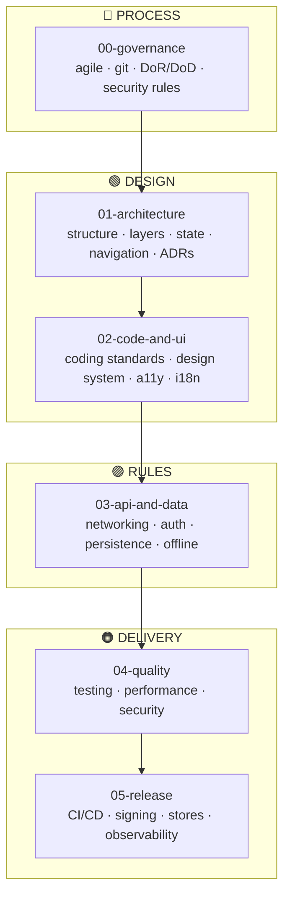

# Healthy Habits Tracker

Mobile app (React Native + Expo) to log daily healthy habits against goals, follow streaks and
progress, and let wellness professionals review their patients' adherence; backed by a NestJS API,
PostgreSQL and Docker.

---

## Ficha del proyecto (c3-project, fase 0)

> Lista cerrada del alcance que se entrega en el corte 3 (guía del proyecto de aula, §5). Las
> decisiones que la fijan están en [ADR-010](./01-architecture/decisions/records/ADR-010-separacion-en-cuatro-repositorios.md)
> y [ADR-011](./01-architecture/decisions/records/ADR-011-roles-y-alcance-completo.md).
> Estado de cada funcionalidad: ✅ implementada y probada (2026-10-28).

| Campo | Respuesta del equipo |
|---|---|
| **Nombre del producto y team de GitHub** | Healthy Habits Tracker · team `healthy-habits-tracker` (organización `code-corhuila`) |
| **Integrantes** | Juan José Horta Vanegas (`Juan-Horta27`, líder) · Daniel Felipe Fernandez Rojas (`Daniel666-ui`; también aparece como `Daniel66-ui` en commits antiguos). Javier Esteban Ortiz López (`Esteban-64210`) se retiró y no está matriculado en el curso: su trabajo de la primera entrega se conserva con su autoría |
| **Problema que resuelve** | Los pacientes de un centro de bienestar reciben recomendaciones de hábitos, pero pierden la constancia porque no tienen una forma rápida de registrar lo que cumplen ni de ver su progreso. El profesional, a su vez, no cuenta con datos objetivos de adherencia para acompañarlos |
| **Funcionalidades (lista cerrada)** | Ver la tabla "Funcionalidades" más abajo |
| **Pantallas** | Login · Crear cuenta · Inicio (dashboard) · Hábitos (con ventana de crear y editar) · Metas (con ventana de crear y editar) · Registros · Nuevo / editar registro (ventana) · Historial · Pacientes · Progreso del paciente |
| **Entidades y relaciones** | `Usuario` (con rol) 1—N `Habito`; `CategoriaHabito` 1—N `Habito`; `Habito` 1—N `Meta`; `Habito` 1—N `RegistroDiario`. Modelo completo en [`03-api-and-data/data-model.md`](./03-api-and-data/data-model.md) |
| **Roles** | **Paciente:** registra y gestiona sus propios hábitos, metas y registros, y ve su dashboard e historial. **Profesional:** consulta la lista de pacientes y el progreso de cada uno por rango de fechas; no crea ni modifica datos de pacientes. Cada rol recibe `403` en los endpoints del otro |
| **Regla de negocio propia** | Un solo registro por hábito y por día, sin fechas futuras (hora de Colombia); el servidor decide si la meta se cumplió (`valor ≥ meta activa`) y calcula la racha de días consecutivos. Además: una sola meta activa por hábito, y un hábito con historial se archiva en lugar de borrarse |
| **Endpoints** | Ver la tabla "Endpoints" más abajo. Contrato: [`03-api-and-data/api-contract.md`](./03-api-and-data/api-contract.md) |
| **Plugin nativo o almacenamiento local** | `expo-secure-store`: guarda el token de sesión cifrado en el teléfono. `AsyncStorage`: caché para abrir la app sin red (S-05) y cola de registros pendientes que se envían al volver la conexión (S-06) |
| **Tecnología** | App: React Native 0.86 + Expo SDK 57 + TypeScript (justificado en [ADR-002](./01-architecture/decisions/records/ADR-002-react-native-expo.md)). API: NestJS 10 + Prisma 5. Base de datos: PostgreSQL 16. Orquestación: Docker Compose |
| **Repositorios** | [`habits-tracker-docs`](https://github.com/code-corhuila/habits-tracker-docs) · `habits-tracker-app` · `habits-tracker-api` · `habits-tracker-infra` (en `code-corhuila`). `healthy-habits-tracker` queda como referencia histórica, sin cambios nuevos |
| **Responsable de cada repositorio** | `-docs`: ambos · `-app`: Juan José Horta Vanegas · `-api`: Daniel Felipe Fernandez Rojas · `-infra`: Juan José Horta Vanegas |

### Funcionalidades

| # | Funcionalidad | Historia de usuario | Origen | Estado |
|---|---|---|---|---|
| F-01 | Crear cuenta e iniciar sesión | Como paciente, quiero crear mi cuenta con mis datos (edad, peso, estatura) e iniciar sesión, para que mis registros queden guardados y solo yo pueda verlos | HU-02 M-01, M-02 | ✅ |
| F-02 | Catálogo de categorías | Como paciente, quiero clasificar mis hábitos en las categorías del centro (Hidratación, Ejercicio, Alimentación, Sueño, Meditación), para seguir un criterio común | M-03 | ✅ |
| F-03 | Gestionar hábitos (crear, ver, editar, eliminar o archivar) | Como paciente, quiero administrar mis hábitos, para seguir solo los que practico sin perder el historial de los que dejo | M-04, C-04 | ✅ |
| F-04 | Gestionar metas (crear, ver, editar, activar/desactivar, eliminar) con una sola activa por hábito | Como paciente, quiero fijar y ajustar un objetivo por hábito, para saber cada día si lo cumplí | M-05, C-04 | ✅ |
| F-05 | Registro diario (crear, ver, filtrar, editar, eliminar), único por hábito y día | Como paciente, quiero anotar en segundos cuánto cumplí de un hábito, para medir mi constancia | M-06, M-12, C-04 | ✅ |
| F-06 | Racha actual y récord | Como paciente, quiero ver cuántos días seguidos llevo cumpliendo, para mantener la motivación | M-07 | ✅ |
| F-07 | Inicio con métricas del día y gráfica semanal | Como paciente, quiero ver de un vistazo cómo voy hoy y esta semana | M-08, S-01 | ✅ |
| F-08 | Historial mensual y semanal | Como paciente, quiero revisar mi cumplimiento por mes y por semana, con el detalle por hábito | S-02 | ✅ |
| F-09 | Panel del profesional | Como profesional, quiero elegir un paciente y un rango de fechas y ver sus días evaluados, días cumplidos, porcentaje de adherencia y racha máxima por hábito | M-09 | ✅ |
| F-10 | Ver mis datos sin conexión | Como paciente, quiero abrir la app sin señal y ver mis últimos datos | S-05 | ✅ |
| F-11 | Registrar sin conexión | Como paciente, quiero registrar mi hábito aunque no tenga señal y que se envíe solo al recuperarla, sin duplicarse | S-06 | ✅ |

Fuera del alcance (HU-02 §4.3 y §4.4): exportar a PDF, recordatorios, gráficas interactivas, widget,
relojes inteligentes, pagos, mensajería, chat e inicio de sesión sin conexión.

### Endpoints

Todos con el prefijo `/api/v1`. **P** = paciente · **Pr** = profesional · — = público.

| Método y ruta | Rol | Estado |
|---|---|---|
| `POST /auth/register` | — (crea cuentas de paciente) | ✅ |
| `POST /auth/login` | — | ✅ |
| `GET /usuarios/me` | P, Pr | ✅ |
| `GET /categorias` | P, Pr | ✅ |
| `GET /habitos` · `GET /habitos/:id` · `POST /habitos` · `PUT /habitos/:id` · `DELETE /habitos/:id` | P | ✅ |
| `GET /metas` · `POST /metas` · `PATCH /metas/:id` | P | ✅ (`PATCH` activa, desactiva y edita valor y descripción) |
| `DELETE /metas/:id` | P | ✅ |
| `GET /registros` · `POST /registros` · `DELETE /registros/:id` | P | ✅ |
| `PUT /registros/:id` | P | ✅ |
| `GET /usuarios?rol=paciente` | Pr | ✅ |
| `GET /reportes/progreso?usuarioId=&fechaInicio=&fechaFin=` | Pr | ✅ |

Cada fila está comprobada por las pruebas e2e de `habits-tracker-api` y la colección Postman; un rol
que llama a una ruta del otro recibe `403 FORBIDDEN_ROLE`, y sin token, `401`.

---

## Overview & tech

Healthy Habits Tracker helps patients of a wellness center keep the healthy habits their
professionals recommend, such as drinking water, walking, sleeping well or meditating.
**Problem:** patients lose consistency because they have no quick way to log what they do each
day or to see their progress, and professionals lack objective adherence data.
**Users:** patients log daily values against a goal and follow their streaks, while wellness
professionals review each patient's adherence over a date range.
**Architecture:** the solution is split into four repositories: a React Native mobile app that only
talks to a REST API, a NestJS API that enforces every business rule and owns the database schema
through migrations, an infrastructure repository that starts PostgreSQL and the API with Docker
Compose, and this documentation repository.
**Stack:** React Native 0.86 with Expo SDK 57 and TypeScript on the client; NestJS 10, Prisma 5
and PostgreSQL 16 on the server; JWT authentication with bcrypt-hashed passwords; Jest and
Supertest for automated tests, plus a Postman collection run with Newman.
**Key decisions:** the server is the single source of truth (one log per habit and day, one active
goal per habit, streaks computed on read), dates travel as plain `YYYY-MM-DD` strings to avoid
time-zone shifts, errors follow RFC 7807, and two roles (patient and professional) are enforced by
the API, which answers 401 without a token and 403 with the wrong role. The app stores the session
token in the device's secure storage, caches data locally so it still opens without a connection, and
queues daily logs made offline, uploading them later with an idempotency key so they are never duplicated.
**How to run:** clone `habits-tracker-infra`, `habits-tracker-api` and `habits-tracker-app` side by
side, copy each `.env.example` to `.env`, run `docker compose up -d --build` in
`habits-tracker-infra`, and then run `npm install` and `npm run web` in `habits-tracker-app`; the
full step-by-step guide is the README of `habits-tracker-infra`.

---

> ### 📌 Política de ramas de este repositorio
>
> **Este repositorio usa una sola rama, `main`**, como pide la guía del corte 3. Los repositorios de
> código (`habits-tracker-app`, `-api`, `-infra`) usan ramas `feat/` o `fix/` y Pull Request revisado
> por el otro integrante. Detalle en [`00-governance/git-conventions.md`](./00-governance/git-conventions.md).
> Entre el 2026-09-21 y el 2026-10-28 este repositorio usó ramas `docs/<sección>`; ese historial se conserva.

---

## Manual de documentación — Mobile Governance Framework

> Documentation manual and governance scaffold for **mobile applications** — stack-agnostic
> (Flutter, React Native, native iOS, native Android). A lighter companion to the
> microservices framework: the same manual-with-templates approach, fewer sections.

**Author:** [Jesus Ariel Gonzalez Bonilla](https://github.com/jesusarielgb-works)

This repository is a **documentation scaffold** for any mobile project. It contains no
project-specific information. Its purpose is to teach how to govern and document a mobile
app professionally — showing what goes in each section, why it matters, and how the
sections relate.

---

## How to use this framework

1. **Fork** (or copy the structure) into your project repository.
2. **Read** [`00-sdd-guide.md`](./00-sdd-guide.md) for the fill-in order and methodology.
3. **Read each section `README.md`** before filling in its documents — they explain what is expected.
4. **Copy the `_template-*` files** when you need to document a concrete feature, screen,
   decision, endpoint, entity, test case, or release. Fill in, rename, keep the original template.
5. **Adapt every neutral rule** to your concrete stack (Flutter / React Native / native).
6. Once a document is complete, remove the instruction blocks.

---

## Build flow — section dependencies

> `00-governance` wraps the entire project and applies to every section.

---

## Sections

| # | Section | Content |
|---|---------|---------|
| [00](./00-governance/) | Governance | Agile process, git conventions, DoR/DoD, security rules |
| [01](./01-architecture/) | Architecture | Project structure, layers, state, navigation, ADRs |
| [02](./02-code-and-ui/) | Code & UI | Coding standards, design system, accessibility, i18n |
| [03](./03-api-and-data/) | API & Data | Networking, auth, persistence, offline & sync |
| [04](./04-quality/) | Quality | Testing strategy, performance budgets, mobile security |
| [05](./05-release/) | Release | CI/CD, signing, store distribution, observability |

Companions:
[monolith-governance-framework](https://github.com/jesusarielgb-works/monolith-governance-framework) ·
[microservices-governance-framework](https://github.com/jesusarielgb-works/microservices-governance-framework)

---

## How to Cite

> Gonzalez Bonilla, J. A. (2026). *Mobile Governance Framework* (v1.0.0). jesusarielgb-works. https://github.com/jesusarielgb-works/mobile-governance-framework

## Contributing

See [CONTRIBUTING.md](CONTRIBUTING.md).

## License

MIT — Jesus Ariel Gonzalez Bonilla. See [LICENSE](LICENSE).

## Autores

- Juan José Horta Vanegas
- Daniel Felipe Fernandez Rojas (desde la salida de Esteban)
- Javier Esteban Ortiz López (integrante anterior; autor de los documentos de la primera entrega)
